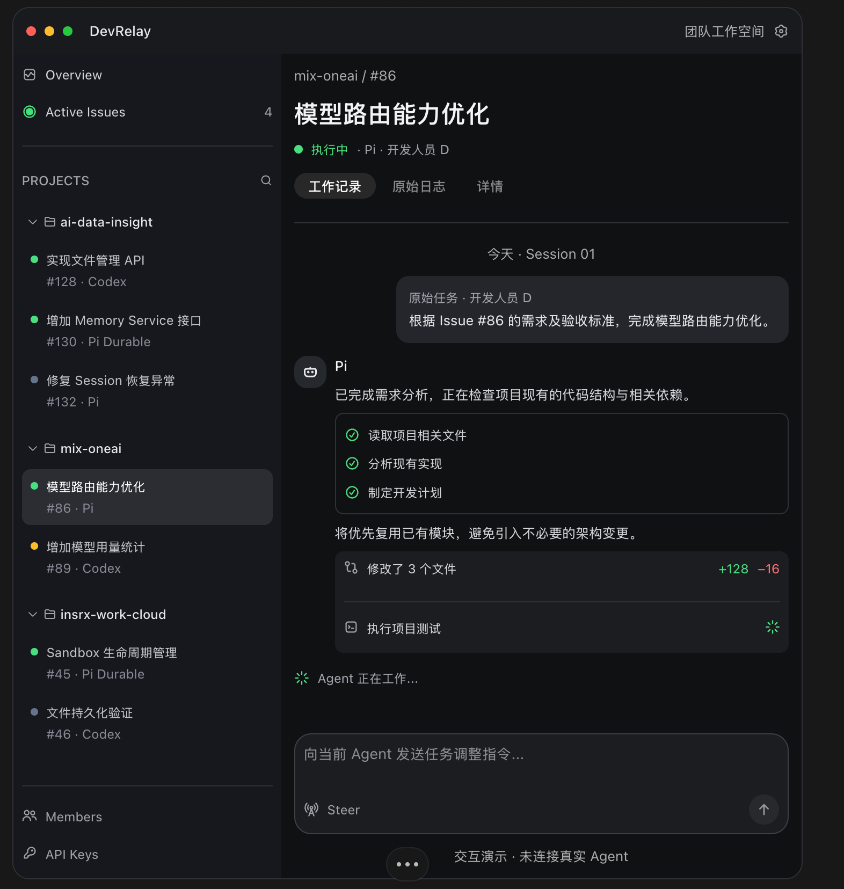

# DevMesh V1.0
## 产品设计与详细开发逻辑规范

**版本**：V1.0 · **日期**：2026-11-25 · **用途**：研发立项、跨团队对齐、任务拆解与验收

**产品定位**：以 Gitea Issue 为协作单元，以本地 Agent 为执行节点，以 Relay 为双向工作记录通信中心的分布式 AI 研发协作平台。

### 设计摘要

| 决策项 | V1.0 方案 |
|---|---|
| 产品边界 | 本期开发本地 Agent、云端 Relay + Web、公共协议；其他功能验证通过后再开发独立移动 App |
| 默认角色 | 后端开发 backend、前端开发 frontend、需求人员 product、测试/验证人员 qa |
| 首版 Runtime | Codex、Pi、Pi Durable；统一安装入口，原生适配，不 Fork 上游 |
| 技术栈 | Rust / Tokio / Axum / PostgreSQL / SQLite；React + TypeScript；原生 TS 扩展 |
| 任务协作 | Skills + 官方 Gitea MCP 直接操作 Gitea；本地 Worker 确定性认领和启动 |
| 记录范围 | 仅明确绑定 Issue 的工作周期；完整消息及工具事件，不要求逐 Token |
| 通信 | Agent 与 Relay 使用 WSS；Web 查询 REST、实时 SSE、指令 REST；后续 App 直接复用 Relay 接口 |
| 远程协作 | 原生 Steer、Follow-up、Prompt、Comment；本地授权与状态校验 |
| 发布要求 | 三种 Runtime 全部通过端到端测试才达到首版正式支持标准 |

**实施范围**：本期仅开发和验证 devmesh-protocol、devmesh-agent、devmesh-relay（含 Web）。devmesh-app 在上述功能验证通过后启动，直接对接 Relay 的 REST/SSE 接口。文中 Web/App 的共同约定描述后续可复用的接口行为，不表示 App 纳入本期开发或发布验收；移动框架选型、原生集成及移动专用能力届时再确定。

### 阅读导航

01 产品目标与架构 · 02 角色与初始化 · 03 Issue 协议与协作 · 04 原子认领 · 05 Worker 与工作区 · 06 Runtime 接入 · 07 Skills/MCP · 08 数据及事件 · 09 指令协议 · 10 云端服务与 API · 11 Web UI 与 App · 12 安全与可靠性 · 13 技术与部署 · 14 开发计划及验收 · 15 技术验证与参考

**规范约定**：“必须”表示发布门槛；“建议”表示可调整的默认值；所有 CLI、API、配置示例为拟开发合同，不代表已经上线。上游能力与实际安装版本的兼容性以技术验证结果为准。

<!-- pagebreak -->
## 01 产品目标与架构

devmesh 让团队中的人员与 Agent 在同一个 Gitea 任务体系内异步协作，并通过 Web/App 实时查看和干预工作。用户只需配置自己的角色、项目目录和 Runtime，后台程序即可按规则发现任务。需求、前端、后端与 QA 可以相互发布 Issue，无须统一模型供应商或计算节点。

### 01.1 系统拓扑

```text
开发人员电脑（多个节点，各自拥有授权凭据）
  Codex / Pi / Pi Durable + devmesh 原生扩展
          |                         |
   Skills + Gitea MCP       Local Rust Daemon
          |                Worker / Bridge / SQLite
          |                         | WSS 双向
      Gitea                         v
  Issue / Git / PR       Relay Server (Rust + React Web)
                                    | PostgreSQL
                                    | REST + SSE
                               Web / Android / iOS
```

| 项目 / 仓库 | 交付物与职责 |
|---|---|
| devmesh-agent | 一个安装入口；Installer、Skills、MCP、Worker、Collector、Controller、Runtime adapters；每个 OS 用户一个本地通信进程 |
| devmesh-relay | Rust 后端、React Web、数据库迁移与部署镜像；接收事件、查询与推送、设备路由、指令转发、审计 |
| devmesh-app | 后续开发的独立 Android/iOS 客户端；其他功能验证通过后直接对接 Relay 接口，本期不实现 |
| devmesh-protocol | JSON Schema、OpenAPI、AsyncAPI、Rust/TS 客户端类型、兼容性 fixtures；不是运行服务 |

### 01.2 边界及事实来源

Gitea 是 Issue、认领协议、代码及 PR 的事实来源；Relay 是已接收的工作事件、设备在线状态及远程指令回执的事实来源。运行实例是否活跃以本地 Runtime 为准。Relay 不持有 Gitea Token，不代理 MCP，不调度 Issue、不执行模型、不托管代码。Web 和 App 只访问 Relay。

Relay 不可用时，已授权的本地任务仍可执行，事件写入本地队列；Gitea 不可用时不得新认领任务或确认交付。云端初期仅一个业务服务及 PostgreSQL；不引入 Kafka、Redis 或独立调度服务。前后端同仓、独立模块、统一镜像部署。

<!-- pagebreak -->
## 02 角色、安装与初始化

### 02.1 四种默认角色

| 角色 ID | 工作内容 | 交付证据 |
|---|---|---|
| backend 后端开发 | API、服务、数据库、后端测试；发现前端/需求缺口时发布对应角色 Issue | Commit、PR、测试结果、API 契约 |
| frontend 前端开发 | 页面、交互、组件、API 集成与前端测试 | Commit、PR、构建/测试结果、交互说明 |
| product 需求人员 | 澄清需求、业务流程、拆解任务、验收标准、业务验证 | 需求文档、任务清单、可验证验收条件 |
| qa 测试/验证人员 | 用例、功能/集成/回归验证、缺陷归类及复测 | 测试报告、环境/版本、证据与 Bug Issue |

允许多角色和项目级覆盖，默认注册上述四项；角色可扩展，不等价于 Gitea 或 Relay 授权。Issue 必须有一个主要执行角色；创建者角色与执行角色分离。

### 02.2 一键安装及用户体验

`devmesh install` 自动检测并安装全部支持的 Runtime 适配，或 `--runtime codex|pi|pi-durable` 指定。首次授权时完成信任及 Token 配置，不绕过 Runtime 的原生安全提示。`devmesh init` 引导用户完成角色选择、Gitea 实例和身份验证、Relay Key、项目目录、每项目 Runtime、并发及远程控制策略。`doctor` 输出每个 Runtime 的安装、事件采集、Steer 能力和失败原因；`update` 支持版本回滚，`uninstall` 仅清除本工具拥有的配置，保留用户数据选项。

| 阶段 | 检查与结果 |
|---|---|
| 检测 | OS/架构、Git、已装 Runtime、依赖及版本矩阵 |
| 安装 | 下载签名/校验和验证的客户端和适配包；备份已有配置；合并不覆盖 |
| 配置 | Gitea MCP、DevMesh MCP、Skills、Runtime 适配、凭据引用、项目权限 |
| 验证 | Gitea 身份、仓库访问、本地目录、Relay 连接、受管测试 Session 与 Steer |
| 运行 | 用户显式开启后台 Worker，可暂停认领、查看状态、停止及恢复 |

首版建议支持 macOS arm64、Linux amd64/arm64；其他 OS 按团队需求纳入发布矩阵。Pi Durable 由标准受管 Host 提供一键使用；第三方宿主须暴露适配入口。不能把安装文件成功等同于 Runtime 能力验收成功。

<!-- pagebreak -->
### 02.3 本地配置合同

```yaml
schema_version: 1
identity:
  roles: [backend, qa]
gitea:
  endpoint: https://git.company.example
  credential_ref: keychain:gitea
relay:
  endpoint: https://relay.company.example
  credential_ref: keychain:devmesh
runtime:
  default: codex
projects:
  - repository: company/adi-backend
    repository_id: 1024
    local_path: ~/workspace/adi-backend
    roles: [backend]
    runtime: codex
    default_branch: main
    concurrency: 1
    auto_claim: true
worker:
  enabled: false
  auto_continue: true
  poll_interval_seconds: 30
  max_concurrency: 2
workspace:
  isolation: git-worktree
  auto_clone: false
collector:
  scope: issue_only
  capture_level: message
  redact_secrets: true
remote_control:
  enabled: false
  allow_steer: true
  allow_follow_up: true
  allow_interrupt: false
  allow_remote_approval: false
```

以上为示例，不包含真实公司域名或密钥。全局角色与项目角色取授权交集；配置变更只影响新认领任务，撤权、暂停采集/控制等安全限制即时生效。身份由 Token/Key 验证获取，不信任用户任意填写的 user_id。默认不自动开启后台开发及远程控制，初始化时明确确认后才启用。命令：`devmesh worker start|pause|status|stop`、`devmesh work <repo>#<issue>`。pause 停止领取新任务，不中断当前任务；stop 应明确是否等待或取消活跃任务。

<!-- pagebreak -->
## 03 Gitea Issue 协议与多角色协作

### 03.1 Issue 字段及标签规范

| 字段/分类 | 必须的规则 |
|---|---|
| title / description | 目标、背景、范围、技术/业务约束 |
| acceptance_criteria | 可验证的验收条件，不接受无边界任务 |
| creator_role / required_role | 创建与执行角色独立；required_role 仅一项 |
| role 标签 | role:backend / role:frontend / role:product / role:qa |
| status 标签 | backlog / ready / claimed / running / review / blocked / rework；统一 status: 前缀 |
| priority / type | priority:p0–p3；type:requirement/feature/bug/test/improvement |
| automation | agent:allowed 或 agent:manual-only；缺失视为不允许自动认领 |
| dependencies / parent | 实例、仓库 ID、Issue 编号及明确依赖条件 |
| claim / delivery | 机器可读认领记录；Commit、PR、报告与测试证据 |

正文中以唯一的 devmesh HTML 注释块存储版本化 JSON 元数据，普通正文面向人。角色/状态标签与协议字段不一致时拒绝自动领取、提示修复；不能用模型猜测。项目管理员初始化标签与策略，非 devmesh Issue 不改变原有流程。

```json
{
  "schema_version": 1, "task_id": "task_01",
  "creator_role": "product", "required_role": "backend",
  "automation_allowed": true,
  "parent_issue": {"repository_id": 1024, "number": 100},
  "dependencies": [], "claim": null
}
```

### 03.2 Issue 创建逻辑

Agent 使用 Skill 判断问题归属及目标仓库，生成任务标题、范围、验收标准、优先级、角色和依赖；通过 Gitea MCP 查重并创建。创建操作使用来源 Issue、任务类型、目标仓库及规范化业务标识生成 dedup_key；超时先查询结果再重试。跨仓依赖记录完整仓库身份和 URL。对于模糊或未授权需求，先创建 product/backlog，不能自动给开发角色派发 ready。

例：QA 发现文件下载接口权限错误，则 creator_role=qa，required_role=backend；创建后端 Bug Issue 并关联 QA 测试任务与失败证据。前端发现 API 缺失，则创建 backend Issue，保留自己的工作进度并报告 blocked。

<!-- pagebreak -->
### 03.3 多角色工作流与依赖

```text
需求人员：产品需求 -> 拆解 -> Backend Issue + Frontend Issue
后端开发：认领 -> 接口实现/测试 -> PR 与 API 契约
前端开发：认领 -> UI/接口集成 -> PR 与测试
测试人员：依赖满足 -> 验证候选版本 -> 报告
   通过：按项目规则审核、合并、关闭任务
   失败：按问题归属创建 Bug Issue -> 修复 -> 复测
```

| 依赖条件 | 何时满足 |
|---|---|
| issue_closed | 前置 Issue 已关闭且符合其交付规则 |
| pr_ready | 指定 PR 存在、未关闭且候选 commit 可验证 |
| artifact_ready | 指定文档/API 契约/测试产物已发布并记录版本 |
| pr_merged | 指定 PR 确实已合并到授权目标分支 |

对依赖图检测循环，不能让 QA 等待开发 Issue 关闭而开发又等待 QA。需求任务、代码任务、验证任务按各自交付规则结束。默认不自动合并，关闭父需求前应验证必要子任务与验收记录。重复发现的 Bug 优先更新既有 Issue，不能形成无限任务循环。

### 03.4 Issue 状态机

| 状态 | 进入条件 / 允许转移 |
|---|---|
| backlog | 需求未澄清；明确角色、验收条件和授权后 -> ready |
| ready | 具备认领条件；CAS 成功 -> claimed；依赖变更 -> blocked |
| claimed | 已获得独占执行权；Runtime 启动成功 -> running；失败 -> blocked 或释放回 ready |
| running | 实际执行；交付证据成立 -> review 或 done（非代码任务）；阻塞 -> blocked |
| review | PR/验收材料已提交，等待规定审核；通过 -> done，失败 -> rework |
| rework | 审核/验证不通过，更新任务要求后 -> ready 或 blocked |
| blocked | 记录原因、依赖/人工处理；解除且无有效认领 -> ready |
| done | 代码按规定合并及验证，或非代码交付通过；以 Gitea closed 表示 |

Issue 业务状态、Session 执行状态与连接状态独立。Session completed 不等于 Issue done。人工重新打开 Issue 应重新校验角色、依赖和认领。禁止 Agent 因输出“已完成”直接关闭任务。

<!-- pagebreak -->
## 04 Issue 原子认领与一致性

### 04.1 认领候选条件

仓库白名单与 Gitea 权限有效、Issue open/ready、角色匹配、agent:allowed、无有效 claim、无其他人工 assignee、依赖满足、本地项目和 Runtime 可用、并发容量足够。按优先级、创建时间排序；加入随机抖动及指数退避。空闲时由 Rust 轮询，不唤醒模型。

### 04.2 唯一执行权

优先采用 Gitea Issue 正文 `content_version` 条件更新（官方当前接口支持正文乐观锁 [R1]）。本地 Claim Manager 使用专用 MCP Tool 或程序级 API，在同一机器可读协议块中保存 claim。仅更新正文并携带预期版本，避免把标签/Assignee 修改误当成原子锁。服务端实际版本必须完成并发验证。若不支持，验证专用 Git Ref 条件创建锁；两者都失败则禁止多人自动认领，不能使用“先读后写”冒充原子锁。

```text
Worker A / B 读取同一 Issue 和版本 v
A: CAS(body + claim_A, expected=v) -> 成功，v+1
B: CAS(body + claim_B, expected=v) -> 409，重新筛选
A: 回读校验 claim_A、最新角色/授权/状态
A: 同步 assignee 与 claimed 标签，再准备工作目录
```

| Claim 字段 | 说明 |
|---|---|
| claim_id / generation | UUID、单调递增代次，记录于协议块，接管时递增 |
| owner / device_id / worker_id | 真实 Gitea 身份、设备与本地执行实例 |
| execution_role / runtime | 本次确定的角色与 Runtime |
| state / claimed_at | active/released/revoked；UTC 时间，仅作记录不作锁依据 |

### 04.3 并发与异常处理

CAS 成功后核对最新业务约束；若资格已变更，CAS 释放自己的 claim，不启动任务。遇到 409 重新读取；网络超时先按 claim_id 查询，结果未知时禁止启动。Assignee/标签投影失败时重试对账，不新建 claim。人工修改正文不得删除协议块，发现破坏时停止任务推进并报警。Claim 只约束遵循协议的客户端，不能阻止 Gitea 管理员或拥有直接写权限的人员绕过它。

首版不按 Relay 心跳超时自动抢占。断线可能意味着原 Agent 仍在执行；接管必须确认旧任务停止或经授权人工处置，并增加 generation。每次 devmesh 管理的外部写操作前重新校验 claim；失效时停止交付。Git 直接 Push 不受 CAS 事务保护，因此必须使用独立任务分支、受保护目标分支和 PR 审核。

<!-- pagebreak -->
## 05 本地 Worker 与后台开发

### 05.1 模块及循环

| 模块 | 职责 |
|---|---|
| Config / Role Router | 用户身份、项目映射、角色及策略校验 |
| Discovery / Scheduler | Gitea 查询、排序、并发控制、公平调度 |
| Claim Manager | CAS、对账、释放、generation 校验 |
| Workspace Manager | Git Remote 校验、目标基线、独立 Worktree |
| Runtime Launcher / Supervisor | 创建、恢复、管理受管进程与 Session |
| Delivery Manager | 验收证据、PR/报告、状态更新、重试 |
| Bridge | Issue 绑定、事件采集、持久化、WSS、控制 |

```text
loop while enabled:
  capacity = min(global_slots, project_slots)
  if capacity == 0: wait_for_completion
  else: list -> filter -> sort -> CAS claim
  reserve_local_slot + persist_claim_and_work
  create_worktree -> attach_collector -> start_runtime
  verify_session -> project_status_running -> monitor
  validate_delivery -> update_issue -> release_claim
  backoff / jitter -> next iteration
```

后台 Scheduler 由 Rust 程序执行，Skills 不负责定时器、原子锁或进程守护。自动任务优先使用专用 Session，不混合私人对话。Worker 自动认领、人工指定 Issue 和交互式 Agent 均可共享 Bridge，但交互式绑定仅在确认 Runtime 能力后开启。

### 05.2 本地项目定位及隔离

以 `(gitea_instance_id, repository_id)` 为仓库主键，校验规范化远程地址（SSH/HTTPS）、权限和真实路径。只扫描用户指定根目录；未找到仓库时跳过，只有显式授权 auto_clone 才克隆。认领前预检，认领后 fetch 授权目标分支并固定 base SHA，创建专属分支 `devmesh/issue-128/<claim_id>` 与 Worktree。不得清理用户已有修改、擅自切换主工作目录或自动删除未提交文件。Worktree 不是安全沙箱；文件/命令访问仍由 Runtime 与 OS 权限控制。

### 05.3 恢复与交付

SQLite 保存 work_id、claim、workspace、runtime native ID、进程标识与事件序号。重启先核对原进程、Runtime 状态及 Claim，不盲目重复启动。无法确定时暂停人工处置。失败保留 Worktree；重试使用新 work_id 或明确同一 Session 恢复，且不重复执行已完成的外部写操作。

开发交付校验 Commit/PR/测试和目标分支；产品交付校验需求文档与子任务；QA 校验测试对象的 Commit SHA、环境、结果和缺陷 Issue。失败/阻塞记录原因；只有证据齐备才释放执行权并按策略更新业务状态。

<!-- pagebreak -->
## 06 Runtime 接入、原生控制与安装

### 06.1 同一架构支持首期及后续控制

| Runtime | 一键交付 | 受管后台执行与采集 | 远程控制 |
|---|---|---|---|
| Codex | Plugin + 官方配置，必要时独立安装 Hooks | devmesh 启动 App Server，thread/start、turn/start、item/started、item/completed | turn/steer（expectedTurnId）、turn/interrupt |
| Pi | Pi Package / TS Extension | RPC mode 启动受管进程；消息/工具事件；交互式 Extension | RPC steer/follow_up，或 Extension 原生消息 API |
| Pi Durable | 标准 Host + TS SDK Adapter | 宿主初始化上游 Harness、持久存储、Conversation 观察与恢复 | 原生忙碌时 steer；验证空闲拒绝和消息幂等语义 |

Codex Plugin 用于分发 Skills/MCP，不代替 App Server 的 Runtime API。首版后台模式由本地 Worker 管理 App Server，明确保证同一个 Thread/Turn；普通 TUI 共享服务的附加控制属于单独兼容测试，未通过时只标记受管模式可用。官方 App Server 的 steer 要求活动 Turn 匹配 [R3]。Pi 原生 Package 和 RPC 支持分发及消息注入 [R4][R5]。Pi Durable 采用上游 SDK，不 Fork；具体宿主版本、API、安装物和许可证需在 D0 锁定并验证，第三方无扩展入口时不能宣称可直接安装。

### 06.2 统一 Adapter 合同

```text
RuntimeAdapter:
  health_check() -> Health + Version
  capabilities() -> Capabilities
  start(StartRequest) -> NativeSession
  resume(ResumeRequest) -> NativeSession
  subscribe(SessionRef) -> EventStream
  status(SessionRef) -> RuntimeStatus
  steer(Command) / follow_up(Command) -> Receipt
  prompt(Command) / interrupt(Command) -> Receipt
  stop(SessionRef) -> Result
```

统一类型必须包含 runtime_instance_id、native_session_id、turn_id、work_id；Pi/Durable Adapter 若无原生 Turn 标识，使用宿主内单调递增的 run epoch 进行匹配。状态/能力来自实际接口和版本，不硬编码全部支持。Tool call 审批遵守原生审批机制。Pi 交互式 sendUserMessage 在空闲时可能启动新轮次，因此 Steer 必须检查 busy 与预期 epoch，并在宿主内原子校验/注入；不能安全拒绝空闲消息时不开放该模式。受管 Pi RPC 优先使用原生 steer 命令并验证返回语义。对 Pi Durable 原生回执、重启恢复与去重分别验收。

<!-- pagebreak -->
## 07 Collaboration Skills 与 MCP

### 07.1 Skill 分发结构

```text
skills/devmesh/
  SKILL.md                     # 统一入口与调用顺序
  references/
    collaboration-protocol.md
    issue-schema.md
    issue-workflow.md
    cross-repository.md
    delivery-policy.md
    security-policy.md
    roles/backend.md
    roles/frontend.md
    roles/product.md
    roles/qa.md
  templates/{requirement,feature,bug,test}.md
```

统一 Skill 指导 Agent 按当前执行角色完成任务、发现依赖、创建 Issue、验证证据与交付。工作开始时读取 Issue 和项目规范；遇到跨角色问题创建关联任务，不擅自修改其他仓库。运行中禁止模型直接修改 devmesh claim 协议块或绕过确定性检查。Agent 的“完成”只是一项建议，由 Worker 验证真实证据。

### 07.2 MCP 能力分界

Gitea MCP 复用官方服务 [R2]，使用用户本人授权凭据直接访问 Gitea。Worker 也可以作为 MCP Client 调用确定性工具。涉及原子认领或严格交付验证且官方 MCP 未暴露必要字段时，由 devmesh 本地窄接口访问 Gitea API；不通过 Relay。以下为自研工具名与合同：

| devmesh MCP Tool | 参数及结果 |
|---|---|
| issue_claim | issue_ref、execution_role -> claim_id、generation 或 conflict |
| issue_release | claim_id、generation、reason -> released / rejected |
| work_start | issue_ref、受信 Runtime 上下文 -> work_id、session_id |
| work_finish / work_status | work_id -> 当前状态；finish 关闭采集边界 |
| work_report_blocked | work_id、reason、dependencies -> accepted |
| work_report_delivery | work_id、evidence_refs -> 校验结果及状态 |
| session_list / session_get | 授权 issue_ref / session_id -> 历史元数据 |
| session_events | session_id、cursor、limit -> 已脱敏事件 |
| project_list | 当前身份 -> 已配置且授权的项目列表 |

每个工具验证来源 Session、角色、项目、Claim 和输入类型。身份与会话绑定从本地可信启动/扩展上下文获得，不允许模型代填其他人的 session_id。公共逻辑放在 Rust Core，stdio MCP 只是入口；Worker、CLI 与 MCP 共用同一实现。Gitea MCP 工具清单、权限及字段覆盖在实际版本验收时冻结。

<!-- pagebreak -->
## 08 数据模型、工作生命周期与实时事件

### 08.1 身份及状态

`issue_ref = (instance_id, repository_id, issue_number)`；每次独立工作分配 work_id，每个主/子 Agent 分配 relay session_id，同时映射 native_session_id、runtime_instance_id 和 parent_session_id。每次认领记录 claim_id/generation。Session 的绑定一旦开始不得修改 issue_ref；换任务新建 Work。历史查询和远程控制都按此关联定位，不能只按 Issue 编号或用户路由。

| 状态轴 | 合法值 |
|---|---|
| Issue | backlog / ready / claimed / running / review / blocked / rework / done |
| Work | preparing / running / blocked / completed / failed / cancelled |
| Session | starting / running / idle / waiting_input / waiting_approval / ended / failed / cancelled |
| Connection | online / offline / reconnecting / unknown |

设备离线时保留最后已知状态，UI 标注 unknown；不把离线自动变成失败。启动时先注册监听与授权的 Issue 绑定，再启动第一条任务指令。Collector 默认关闭；只接受明确工作周期的事件。交互模式结束绑定后立即停止采集，禁止回溯此前的 Session 文件。对于可能混入私人内容的交互 Session，首版默认不允许共享，优先使用专用 Work Session。

### 08.2 事件 Envelope

```json
{
  "protocol_version": "1.0", "event_id": "evt_001",
  "work_id": "work_001", "session_id": "ses_001",
  "sequence": 128, "occurred_at": "2026-11-25T11:35:20Z",
  "type": "tool.completed",
  "payload": {"tool": "shell", "summary": "执行单元测试",
              "exit_code": 0, "duration_ms": 12400}
}
```

| 事件族 | 代表类型 |
|---|---|
| Issue / Work | issue.created、issue.claimed、issue.updated、work.started、work.blocked、work.completed |
| Session / Turn | session.started、session.status、session.ended、turn.started、turn.completed |
| Message / Tool | message.completed、tool.started、tool.completed、tool.failed |
| Plan / File / Git | plan.updated、file.changed、git.committed、pr.created、pr.merged |
| Usage / Command | usage.updated、command.received、command.accepted、command.result |

消息级采集，不拼接逐 Token。默认仅共享可见工作消息、工具摘要、路径/统计及测试结果；不发送隐藏推理、秘密、完整源码或无关对话。未知原生事件按受限扩展类型记录或丢弃；不得制造不存在的进度。

<!-- pagebreak -->
### 08.3 传输、断线恢复及低延迟

Runtime -> Collector 校验/脱敏 -> SQLite Spool -> WSS -> Relay 持久化 -> ACK -> SSE -> Web/App。每条 Session 事件分配单调 sequence；SQLite 事务持久化后发送，服务端提交成功才 ACK。ACK 为连续最高序号，断线重发未确认记录。服务端 `(session_id, sequence)` 与 event_id 唯一；相同键不同内容拒绝并记录冲突。至少一次传输 + 幂等去重，不承诺 Exactly Once。

历史补传使用限速和独立有界队列。控制消息优先于补传；单连接无法达到目标时，可将控制与大批量事件拆为独立 WSS 通道，但仍共用统一协议。事件大小与队列容量可配置；达到上限时明确告警、保留关键事件及缺口标记，不静默覆盖。控制、采集或网络失败不得无限阻塞 Runtime。

| 建议初始 SLO（待压测） | 指标 |
|---|---|
| Runtime 完整事件产生至前台页面展示 | P95 ≤ 500 ms（良好网络条件） |
| Relay 接收事件至持久化并发布 | P95 ≤ 100 ms |
| Relay 接受指令至 Bridge 收到 | P95 ≤ 300 ms |
| WSS 心跳 / 离线判断 | 10 秒 / 连续 3 次缺失后标记不确定 |
| 普通事件小批次聚合 | 20–50 ms；终态、失败和控制回执优先发送 |

SLO 不包含模型生成耗时或工具安全执行边界；设备休眠、移动 App 后台、断网不属于正常在线延迟测量。统一以服务端接收时钟及经校准的客户端时间采样计算端到端延迟。支持事件 occurred_at 和 received_at，UI 不依赖客户端时间决定授权或重放。

### 08.4 Catalog 同步

Web 必须列出授权项目的所有 Issue，包括未产生 Session 的任务。因此本地 Worker 在项目初始化、周期轮询和 Issue 写入后，通过 Gitea MCP 获取最小元数据并上报 catalog.upsert：仓库标识、Issue 编号、标题、URL、角色、状态、负责人、优先级、Gitea updated_at 和同步时间。

Relay 仅存只读投影，不直接查 Gitea。仅允许已授权共享项目写入；多设备更新按来源版本/更新时间比较，不让旧快照覆盖新记录。全量同步必须有 snapshot_id、分页及完成标志；局部查询不能被误当删除。离线显示最后同步时间及过期标记。项目撤权后立即停止访问和同步；历史数据按公司保留策略处置。

<!-- pagebreak -->
## 09 远程指令、路由及回执

### 09.1 指令语义

| 类型 | 合法目标及行为 |
|---|---|
| steer | 正在运行且目标 Turn/epoch 匹配，原生注入；空闲或过期拒绝 |
| follow_up | 活跃 Work 的后续任务，按 Runtime 队列语义执行；结束 Work 时取消 |
| prompt | 仍开放且空闲的 Issue Session；明确开始新轮次 |
| comment | 仅协作记录，不触发 Runtime |
| interrupt | 更高权限、本地允许时中断；默认关闭 |

一期即完成底层双向链路和三 Runtime Steer 验证；UI 只有在权限、连接、Work 和 Runtime 能力均满足时显示可用按钮。远程控制默认关闭、需要 Session 所有者授权；不可远程提高沙箱、绕过审批、修改系统权限或直接执行任意 shell。消息作为普通用户任务输入受原有策略约束。

```json
{
  "command_id": "cmd_001", "type": "steer",
  "target": {"work_id": "work_001", "session_id": "ses_001",
    "runtime_instance_id": "rt_001", "expected_turn_id": "turn_008",
    "claim_generation": 1},
  "payload": {"message": "保持现有 API 兼容性。"},
  "ttl_seconds": 30
}
```

### 09.2 处理与状态

Web/App -> Relay 鉴权、保存命令、路由当前设备连接 -> Bridge 按工作周期、设备实例、Claim、Turn、过期时间及本地授权校验 -> Adapter 原生注入 -> 事件/回执 -> Relay -> Web/App。Relay 用服务端时间设置 expires_at；重新连接时不得投递过期 Steer。命令 ID 幂等；Bridge 持久化去重，注入与本地状态检查在同一宿主执行序列内完成。无法确认是否已注入时标记 unknown，不盲重试。

| 状态 | 含义 |
|---|---|
| pending / delivered | Relay 已持久化 / Bridge 已接收 |
| accepted / applied | Runtime 已接受 / 有原生事件证明进入上下文 |
| rejected / expired | 权限、状态冲突、过期；未执行 |
| unknown | 可能已执行但回执不可确认，需要人工核对 |

accepted 不是 applied，applied 也不是 Agent 已遵循。不得自动将过期 Steer 转为 Prompt。已运行的工具副作用不会自动撤销。所有命令记录发送者、目标、时间及真实回执；历史 Session 只读。

<!-- pagebreak -->
## 10 Relay Server 详细设计

### 10.1 模块与存储

Rust 模块化单体：Auth/ACL、Connection、Catalog、Session、Event Ingestion、Event Projection、Broadcast、Query、Command Router/Store、Audit、Web Host。PostgreSQL 通过 SQLx 管理迁移；事件 JSONB，元数据及高频筛选字段结构化。首版一个 Relay 实例；扩容时再设计跨实例连接路由和发布协调。

| 表 | 主字段/约束 |
|---|---|
| users / api_keys | user_id、key_hash、scopes、expires_at、revoked_at |
| devices / project_members | device_id、owner、last_seen；project_id、user_id、permission |
| projects | id、instance_id、repository_id、name；联合唯一 |
| issue_snapshots | project_id、issue_number、role、status、updated_at、synced_at；联合唯一 |
| work_records | work_id、issue_ref、claim_id/generation、user_id、role、status |
| sessions | session_id、work_id、device_id、native_id、runtime_instance_id、status、capabilities |
| session_events | event_id、session_id、sequence、type、payload、occurred_at、received_at；唯一约束 |
| event_feed | cursor、project_id、event_id、kind；发布序号按提交顺序 |
| commands / command_receipts | command_id、sender_id、target、payload、expires_at、state；回执历史 |
| subscriptions / audit_logs | 关注项、阅读位置；actor、action、resource、result、created_at |

Relay 不建立任务调度锁表，Claim 仅作为日志上下文。事件写入、状态投影和可重放 feed 同事务提交；不要直接使用 PostgreSQL sequence 假设提交顺序。初期可用单实例串行发布事务或带锁的 feed 计数器确保稳定发布顺序；压测后再调整。SSE 慢消费者使用有界缓冲，溢出时要求重新连接及恢复游标。

### 10.2 WebSocket 消息

| 消息 | 方向 |
|---|---|
| connection.register / ack / heartbeat | 双向注册、版本协商、设备在线 |
| catalog.upsert / catalog.snapshot | Client -> Relay 项目/Issue 快照 |
| work.register / session.register / session.status | Client -> Relay 工作及会话注册/状态 |
| session.events / events.ack | Client -> Relay / Relay -> Client 持久化确认 |
| command.dispatch / command.receipt | Relay -> Client / Client -> Relay 控制和回执 |
| protocol.error | 双向错误、版本不兼容、权限或队列冲突 |

连接重建通过设备身份、连接 epoch、可恢复 Session 与 ACK 游标握手。旧连接失效后不允许继续路由；接收事件仍须核对授权和 Work 归属。连接能力与协议版本必须显式协商。

<!-- pagebreak -->
### 10.3 对外 API 合同

统一服务地址：Web `/`，API `/api/v1`，WSS `/ws/v1/connect`。以下路由为拟开发合同；JSON Schema/OpenAPI 中固定字段、鉴权、错误和分页语义。

| Method / Path（相对 /api/v1） | 功能 |
|---|---|
| POST /auth/login | Web/App 用户登录 |
| POST /auth/pair | 设备关联（一次性凭证、短有效期） |
| GET /projects | 已授权项目、运行计数、同步时间 |
| GET /projects/{id}/issues | 过滤、搜索、分页的 Issue 树 |
| GET /issues/{id} | Issue 及最新运行摘要 |
| GET /issues/{id}/works | 所有工作周期与 Session |
| GET /sessions/{id} | Session 快照、能力、连接、游标 |
| GET /sessions/{id}/events | 游标分页的历史事件 |
| GET /sessions/{id}/messages | 对话式事件投影 |
| GET /events/stream | 授权项目列表及状态 SSE |
| GET /sessions/{id}/stream | 指定 Session 实时 SSE |
| POST /sessions/{id}/commands | 发送远程指令；返回 command_id 和状态 |
| GET /sessions/{id}/commands | 指令历史及回执 |
| GET /devices | 当前用户/授权项目设备 |
| GET /subscriptions | 关注与阅读位置 |
| PUT /subscriptions/{id} | 更新关注/阅读位置 |

管理端另有用户、项目 ACL、Key 签发/撤销、审计、保留策略接口，仅管理员可用。错误码：400 参数、401 未认证、403 无权限、404 不可见/不存在、409 状态冲突、410 游标过期、429 限流、503 服务不可用。统一 request_id、error.code、message、retryable；敏感信息不返回。

快照读取与 SSE 游标必须一致，查询后从 cursor 继续；`Last-Event-ID` 恢复，超过保留期限重取快照。浏览器 SSE 建议同源 HttpOnly 会话 Cookie；App 使用授权请求头及安全凭据，不把长效 Token 放入 URL。SSE 在连接建立及权限变更时检查 ACL，撤权后关闭对应流。客户端只渲染授权事件，按 event_id 去重；断线显示重连状态。

<!-- pagebreak -->
## 11 Web 工作台 UI 设计



*图 1　用户确认的 Web 工作台设计参考（原图嵌入，示例数据）。左侧按项目折叠 Issue，右侧显示当前 Issue 的 Session 工作记录与远程指令输入框。*

<!-- pagebreak -->
### 11.1 Web 信息架构及交互规范

Workspace 是默认首页，采用聊天工作区，而非传统监控大盘。左侧项目树可展开、折叠、搜索、收藏；每个项目展示全部已同步 Issue，运行任务优先，历史任务分页。选中 Issue 后，右侧展示项目/编号、标题、角色、人员、Runtime、连接状态、Session 选择器及最近同步时间。多个活跃 Session 时必须明确选中目标，不能广播指令。

| 区域 | 交互要求 |
|---|---|
| 左侧 Projects | 折叠、项目/Issue 搜索、角色与状态筛选、活跃计数；稳定复合 ID |
| Issue 状态 | 绿点=在线且真实 running；黄=等待输入；蓝=待审核；红=失败；灰=未开始/已结束；离线专用图标 |
| 工作记录 | 用户任务、Agent 完整消息、可折叠工具/测试/文件摘要、远程消息与回执；按事件顺序 |
| 原始日志 | 结构化事件、过滤、分页、复制授权范围内内容 |
| 详情 | Gitea 链接、执行角色、Claim、分支、Commit/PR、依赖、用量、执行时间 |
| Session 选择 | 默认活跃，否则最近；多次执行/重试/交接可切换，历史只读 |
| 底部输入 | Steer / Follow-up / Prompt / Comment；状态及权限决定启用；提交后真实回执 |

长日志采用虚拟列表；用户向上滚动时暂停自动跟随，提示新事件数量；点击恢复跟随。首次打开未认领 Issue 显示等待角色领取，不生成虚假会话。等待 Review 的任务不显示正在运行绿点；离线保留最后已知状态并提示可能过期。绿色点可做轻微呼吸动画，提供文字状态与减少动态效果选项。

Overview、成员、设备、API Keys、设置、审计作为辅助入口。默认深色主题，可后续支持浅色。禁止渲染来自日志的可执行 HTML/JS；Markdown、代码块、终端 ANSI 控制序列经安全处理。

### 11.2 Mobile App（后续阶段）

App 在 Agent、Relay 和 Web 功能验证通过后再开发，不参与本期实现与验收。直接复用 Relay 的 REST/SSE 接口和公共协议类型；移动专用接口需求在 App 阶段确认。以下交互与技术方案保留为后续参考，不构成本期任务。

独立 App 沿用同一信息架构：项目列表 -> Issue 列表 -> Session 对话。首屏显示在线任务数、关注任务和最近活动，支持搜索、历史查询、Session 切换、复制工作摘要、原生 Steer 与 Comment。二维码仅包含一次性短期关联凭证；登录后通过系统安全存储保存可撤销设备凭据。Web/App 同账号共享关注及阅读位置，Session 内容由 Relay 统一读取。

前台 SSE、后台恢复时重新获取快照并续订游标；不能依赖移动 OS 长期保持连接。完成、失败、待确认通知可后续接 APNs/FCM，并默认隐藏敏感内容。移动端建议先验证 Tauri 2 + React（复用 TS 类型/部分组件），与 Flutter 对比安全存储、推送、后台恢复、包体及签名后冻结；App 不直接连接 Gitea 或开发电脑。

<!-- pagebreak -->
## 12 权限、安全与运行可靠性

| 风险 | 必须的控制措施 |
|---|---|
| 冒充身份 | Relay Key 绑定真实用户和 scope；Gitea 凭据分离；设备注册时校验所有权 |
| 越权读取 | 项目 ACL 与 Session 归属双重校验；跨项目搜索、SSE、导出、Catalog 同样鉴权 |
| 越权控制 | session:read/comment/steer/interrupt 分开授权；本地显式 opt-in，控制目标/TTL 校验 |
| 敏感日志 | 本地白名单字段、脱敏、最大长度、输出摘要；服务端二次过滤；默认不传源码/隐藏推理 |
| 恶意 Issue/日志 | 任务内容是非可信输入，不能改变系统规则、授予权限、调用任意外部服务；渲染安全 |
| Agent 命令执行 | 保留 Runtime sandbox/approval；专用 Worktree、最小权限账号、凭据不注入不相关子进程 |
| 供应链 | 固定发布版本与依赖锁；校验签名/哈希；安装时不覆盖用户配置，支持回滚 |
| 远程命令重复 | 持久化去重、原生状态校验、回执丢失时 unknown；不盲目重放 |
| 数据保留 | 详细事件建议 90 天；审计及摘要按公司策略；加密传输、备份及删除流程 |

本地 Collector 仅在明确 Issue 工作周期内启动；不进行全局 Session 扫描。日志脱敏不可保证发现所有秘密，所以需要最小化采集与项目共享授权。Relay 无法自行验证 Gitea 的实时仓库 ACL；必须由管理员明确登记项目及成员，离职/撤权时同步撤销 Relay ACL 与设备 Key，不默认全员可看全部项目。远程控制权限不随角色自动扩大。

### 12.1 异常与恢复策略

| 故障 | 系统行为 |
|---|---|
| Relay 离线 | 本地 Spool 持久化；Gitea 研发流程继续；恢复后重传 |
| Gitea 离线 | 停止新领取及外部交付；已执行记录仍上传；恢复核验 Claim |
| Runtime 崩溃 | 记录异常，保留 Worktree；确认原实例后恢复或人工重试 |
| 电脑休眠/断网 | Relay 标记 offline/unknown；不自动抢占；过期指令失效 |
| 数据库不可用 | Relay 不 ACK 未提交事件，客户端继续缓存；控制无法持久化则拒绝 |
| 配额/磁盘不足 | 告警、限速、标明日志缺口；不静默丢失关键事件 |

安全事件与普通业务日志分开审计；导出权限、Key 轮换、设备撤销均留痕。恢复测试覆盖备份还原及事件游标失效。

<!-- pagebreak -->
## 13 技术选型、仓库与部署

| 组件 | 实现 |
|---|---|
| Rust Core | Tokio、Serde、Clap、Tracing；共享协议类型 |
| Relay Backend | Axum REST/WebSocket/SSE、SQLx PostgreSQL、Rustls |
| Local Daemon | Tokio、SQLite Spool、WSS、受限本地 Unix Socket、进程守护 |
| Native Adapters | Codex JSON-RPC（Rust）；Pi/ Pi Durable TypeScript 薄适配 |
| Skills/MCP | SKILL.md、官方 Gitea MCP、自研 devmesh MCP（本地 stdio） |
| Web | React + TypeScript + Vite；后端托管构建产物 |
| App | 后续独立开发与发布；框架届时验证确定，Tauri 2 + React / Flutter 仅作候选 |

```text
devmesh-agent/     Cargo workspace + packages/ + skills/
  crates/{cli,installer,worker,claims,workspace,bridge,
          collector,controller,storage,mcp,runtime-codex}/
  packages/{codex-plugin,pi-extension,pi-durable-host}/
devmesh-relay/     backend/ + web/ + migrations/ + deploy/
devmesh-app/       后续阶段：mobile app source + native integrations/
devmesh-protocol/ schemas/ + openapi/ + asyncapi/ + fixtures/
```

各仓独立发布，依赖版本化的协议与 SDK，不引用其他仓的内部实现。协议按 major/minor 协商，增加可选字段保持向后兼容；不兼容 major 明确拒绝。Rust 选择依据是长期本地进程、强类型状态机、资源管理及可部署二进制，不假设其天然降低网络延迟。TS 适配保持上游生态，不为统一语言重写 Runtime。

### 13.1 部署与运维

云端 Docker Compose：devmesh-relay（React 静态资源 + Axum）及 PostgreSQL；TLS 入口可复用公司反向代理。配置 WSS upgrade、SSE 禁止代理缓冲、合理 idle timeout、健康检查、备份与持久卷。运维指标：事件写入/推送延迟、队列积压、连接数、命令回执、DB 写入失败、Spool 饱和率。禁止将真实密钥写进镜像、配置仓库或日志。首版单实例不承诺 HA；扩容前验证跨实例路由、持久化广播与连接所有权。

本地进程每个 OS 用户单实例，按需启动或由用户授权开机运行；IPC 文件仅所有者访问。升级前暂停领取并处理在途工作，记录版本；失败回滚。初始平台版本表、Release 签名、校验和、许可证清单和安装脚本由 CI 发布。移动 App 的签名、系统通知权限及生命周期测试在后续 App 阶段独立管理。

<!-- pagebreak -->
## 14 开发拆解与发布验收

| 阶段 / 仓库 | 任务包与交付物 |
|---|---|
| D0 技术验证 | PROTO-01 协议样例；AGENT-01 三 Runtime 启动/完整事件/同一 Session Steer 原型；AGENT-02 Gitea 原子认领并发验证；AGENT-03 一键安装与宿主验证 |
| D1 Protocol | JSON Schema、OpenAPI、AsyncAPI、状态机、版本协商、错误码、跨语言 fixtures 与 Mock Relay |
| D1 Agent | Installer/doctor、凭据与角色、项目映射、Skills/MCP、CAS、Worker、Worktree、三个 Adapter、SQLite Spool、控制权限 |
| D1 Relay | Auth/ACL、Catalog、连接注册、Session/Event Store、Feed/SSE、Command Router、审计、迁移及部署 |
| D2 Web | 项目树、Issue/Session 对话、原始日志、状态、历史、真实回执及管理页 |
| D3 集成发布 | Protocol、Agent、Relay 与 Web 的 E2E、故障注入、并发/性能、安全测试、升级回滚、安装包、部署文档和运维手册 |
| 后续 App | D3 功能验证通过后启动；直接对接已验证的 Relay REST/SSE 接口，完成移动客户端及移动专用验收 |

D0 是冻结架构的硬门槛。D1 可并行开发 Agent/Relay；Web 基于协议 Mock 并行。App 等其他功能完成 D3 验证后再开发，其选型与实现不阻塞本期发布。V1.0 交付目标包含三个 Runtime、后台自动领取、实时共享及原生 Steer；不推迟到下一版才选择控制接口。远程功能默认关闭，可按授权逐步启用。

### 14.1 关键验收清单

| ID | 验收场景及通过条件 |
|---|---|
| T01 | 全新受支持电脑一键安装三 Runtime，doctor 验证能力；升级/回滚不破坏用户配置 |
| T02 | 四种角色跨仓创建/领取；缺角色、未授权、依赖未满足的 Issue 不被认领 |
| T03 | 至少 20 个并发 Worker 同抢一 Issue，仅一份有效 claim、仅一个任务启动；超时与 409 正确恢复 |
| T04 | 同机并行不同任务，独立 Worktree；人工主目录保持不变；重启不重复启动 |
| T05 | Codex/Pi/Pi Durable 各自完成一次后台任务，准确识别 native Session、事件、提交/报告 |
| T06 | Web 完整消息和工具事件实时可见；无私人 Session、秘密或隐藏推理外泄 |
| T07 | 三 Runtime 同一活动 Session 原生 Steer；本地可见；过期、错误 Turn、跨设备及未授权指令拒绝 |
| T08 | 断网、Relay/DB 重启后已提交事件不丢失、不重复展示；未知命令不盲重试 |
| T09 | Catalog 列出未认领 Issue，旧快照不覆盖新状态，离线时显示过期标记 |
| T10 | Gitea/Relay 独立故障、撤权、日志容量、恶意输入、备份恢复及延迟 SLO 均通过测试 |

<!-- pagebreak -->
## 15 技术验证门槛与参考资料

### 15.1 必须冻结的上游兼容合同

| 验证项 | 冻结条件 / 不通过时的处理 |
|---|---|
| Gitea CAS | 检查实际部署版本、GET 是否返回版本、PATCH 正文并发冲突及权限；通过后才启用自动领取。否则验证 Git Ref 锁，失败则阻止自动认领 |
| Codex | 固定官方 CLI 版本、App Server schema、受管后台事件和原生 steer；共享 TUI 模式另测多客户端与审批路由，不阻塞受管模式 |
| Pi | 固定 Package/RPC 版本；后台 steer 在 idle/turn 切换时必须安全拒绝；事件覆盖与 Extension 信任验证 |
| Pi Durable | 明确上游源码/包版本、许可证、标准 Host 初始化与工具加载，验证持久化观察、原生 steer、空闲拒绝、崩溃恢复及一键分发 |
| Mobile（后续） | 本期 D0 不执行；其他功能验证通过后，在 App 阶段验证 Tauri 2 / Flutter 的前台 SSE、后台恢复、安全存储、设备关联及签名，再冻结框架 |

上述为实现验证门槛而非已运行的测试结果。部署的 Gitea 版本、公司现有 Pi Durable Host 源码以及三 Runtime 的实际安装环境均需要开发团队提供并完成验证。禁止以模拟回执、只读历史或新起 Session 冒充运行中 Steer。

### 15.2 官方文档与依据

[R1] Gitea Issue 编辑 API（正文 content_version 乐观锁）：https://docs.gitea.com/api/operations/issue-edit-issue/

[R2] Gitea MCP 官方项目：https://gitea.com/gitea/gitea-mcp

[R3] Codex App Server（Thread、Turn、Steer 与事件）：https://learn.chatgpt.com/docs/app-server

[R4] Pi Packages：https://docs.pi.dev/latest/packages

[R5] Pi RPC Commands：https://docs.pi.dev/latest/rpc-commands

[R6] OpenAI Plugin 打包及 Hooks 信任说明：https://developers.openai.com/plugins/build/plugins

[R7] Git Worktree：https://git-scm.com/docs/git-worktree

[R8] Git Push 条件更新：https://git-scm.com/docs/git-push

Pi Durable 的具体上游 SDK/宿主版本未在本次取得可核验的官方版本文档，因此不冻结未经验证的方法签名；由 D0 产出依赖锁、原生接口 fixture 和许可证清单。R1/R3/R4/R5/R6 为本次核对的在线官方文档，其他项目链接作为开发参考。

**本期交付定义**：在同一个 Gitea 协作体系中，四种角色的 Agent 可以安全地创建、认领、开发及验证 Issue，三种 Runtime 一键使用，团队成员在 Web 中查看真实工作记录，并对明确授权的活跃 Session 进行原生任务调整。Relay 始终不承担中心化任务调度。
