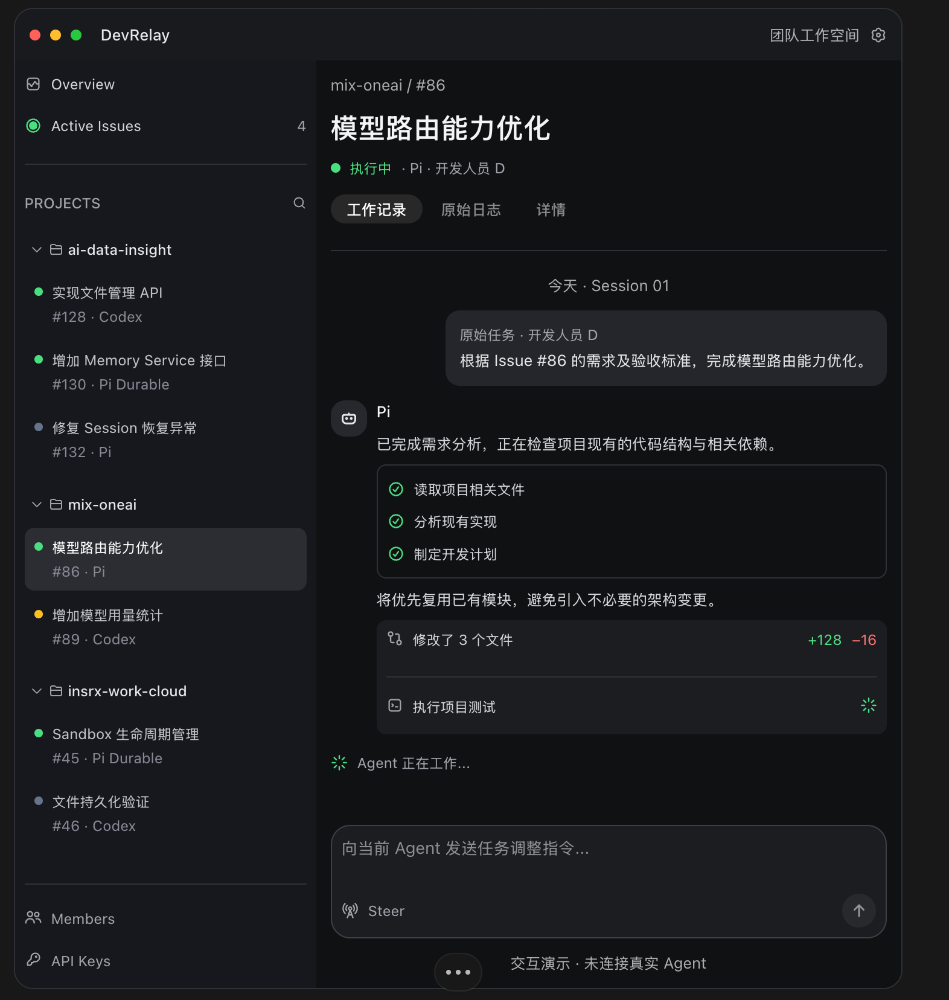

# DevMesh V1.1
## 产品设计与详细开发逻辑规范

**版本**：V1.1 · **日期**：2026-11-25 · **用途**：研发立项、跨团队对齐、任务拆解与验收

**产品定位**：以 Gitea Issue 为协作单元，以本地 Agent 为执行节点，以 Relay 为双向工作记录通信中心的分布式 AI 研发协作平台。

### 设计摘要

| 决策项 | V1.1 方案 |
|---|---|
| 产品边界 | 本期本地 Agent、云端 Relay + Web、公共协议；App 待其他功能验证通过后开发，直接对接 Relay 接口 |
| 默认角色 | 后端开发 backend、前端开发 frontend、需求人员 product、测试/验证人员 qa |
| 首版 Runtime | Codex、Pi、Pi Durable；统一安装入口，原生适配，不 Fork 上游 |
| 技术栈 | Rust / Tokio / Axum / PostgreSQL / SQLite；React + TypeScript；原生 TS 扩展 |
| 任务协作 | Skills + 本地 MCP；官方 Gitea MCP 直接访问，Worker 管理认领与交付 |
| 记录范围 | 仅明确绑定 Issue 的工作周期；经策略允许的完整消息及工具事件，不要求逐 Token |
| 通信 | Agent 与 Relay 使用 WSS；Web/App 查询 REST、实时 SSE、指令 REST |
| 远程协作 | 原生 Steer、Follow-up、Prompt、Comment；本地授权与状态校验 |
| 发布要求 | 三种 Runtime 全部通过端到端测试才达到首版正式支持标准 |

**实施范围**：App 延后至其他功能验证通过后开发，复用 Relay REST/SSE；移动选型、配对与移动专用验收不纳入本期。先完成本地 Skill 与 Gitea 协作，再开发 Relay/Web；真实 Token/Key 验证最后执行，开发测试使用隔离的本地测试服务和合成凭据。三 Runtime 适配与一键安装仍属本期。

### 阅读导航

01 产品目标与架构 · 02 角色与初始化 · 03 Issue 协议与协作 · 04 原子认领 · 05 Worker 与工作区 · 06 Runtime 接入 · 07 Skills/MCP · 08 状态与事件 · 09 指令协议 · 10 云端及初始化 · 11 Web UI · 12 App · 13 安全与部署 · 14 开发计划及验收 · 15 技术验证与参考

**规范约定**：“必须”表示发布门槛；“建议”表示可调整的默认值；所有 CLI、API、配置示例为拟开发合同，不代表已经上线。上游能力与实际安装版本的兼容性以技术验证结果为准。


**V1.1 关键修订**：Assignee 仅人工指派；Claim 释放须确认执行停止；终态 Work 只读；审批本地处理；协议与样例单独版本化；Catalog 单项目发布租约；交付按不可变候选版本验证。详细评审闭环见 `review-resolution.md`。

## 01 产品目标与架构

DevMesh 让团队中的人员与 Agent 在同一个 Gitea 任务体系内异步协作，并通过 Web/App 实时查看和干预工作。用户只需配置自己的角色、项目目录和 Runtime，后台程序即可按规则发现任务。需求、前端、后端与 QA 可以相互发布 Issue，无须统一模型供应商或计算节点。

### 01.1 系统拓扑

```text
开发人员电脑（多个节点，各自拥有授权凭据）
  Codex / Pi / Pi Durable + DevMesh 原生扩展
          |                         |
   Skills + Gitea MCP       Local Rust Daemon
          |                Worker / Bridge / SQLite
          |                         | WSS 双向
      Gitea                         v
  Issue / Git / PR       Relay Server (Rust + React Web)
                                    | PostgreSQL
                                    | REST + SSE
                               Web / Android / iOS
```

| 项目 / 仓库 | 交付物与职责 |
|---|---|
| devmesh-agent | 一个安装入口；Installer、Skills、MCP、Worker、Collector、Controller、Runtime adapters；每个 OS 用户一个本地通信进程 |
| devmesh-relay | Rust 后端、React Web、数据库迁移与部署镜像；接收事件、查询与推送、设备路由、指令转发、审计 |
| devmesh-app | 独立 Android/iOS 客户端；关联账号、浏览项目和工作记录、发送授权指令 |
| devmesh-protocol | JSON Schema、OpenAPI、AsyncAPI、Rust/TS 客户端类型、兼容性 fixtures；不是运行服务 |

### 01.2 边界及事实来源

Gitea 是 Issue、认领协议、代码及 PR 的事实来源；Relay 是已接收的工作事件、设备连接观测及远程指令回执的事实来源；Catalog publisher lease 仅协调元数据同步。运行实例是否活跃以本地 Runtime 为准。Relay 不持有 Gitea Token，不代理 MCP，不调度 Issue、不执行模型、不托管代码。Web 和 App 只访问 Relay。

Relay 不可用时，已授权的本地任务仍可执行，事件写入本地队列；Gitea 不可用时不得新认领任务或确认交付。云端初期仅一个业务服务及 PostgreSQL；不引入 Kafka、Redis 或独立调度服务。前后端同仓、独立模块、统一镜像部署。

## 02 角色、安装与初始化

### 02.1 四种默认角色

| 角色 ID | 工作内容 | 交付证据 |
|---|---|---|
| backend 后端开发 | API、服务、数据库、后端测试；发现前端/需求缺口时发布对应角色 Issue | Commit、PR、测试结果、API 契约 |
| frontend 前端开发 | 页面、交互、组件、API 集成与前端测试 | Commit、PR、构建/测试结果、交互说明 |
| product 需求人员 | 澄清需求、业务流程、拆解任务、验收标准、业务验证 | 需求文档、任务清单、可验证验收条件 |
| qa 测试/验证人员 | 用例、功能/集成/回归验证、缺陷归类及复测 | 测试报告、环境/版本、证据与 Bug Issue |

允许多角色和项目级覆盖，默认注册上述四项；首版角色枚举固定四种；未来角色扩展需协议升级，不等价于 Gitea 或 Relay 授权。Issue 必须有一个主要执行角色；创建者角色与执行角色分离。

### 02.2 一键安装及用户体验

`devmesh install` 自动检测并安装全部支持的 Runtime 适配，或 `--runtime codex|pi|pi-durable` 指定。首次授权时完成信任及 Token 配置，不绕过 Runtime 的原生安全提示。`devmesh init` 引导用户完成角色选择、Gitea 实例和身份验证、Relay Key、项目目录、每项目 Runtime、并发及远程控制策略。`doctor` 输出每个 Runtime 的安装、事件采集、Steer 能力和失败原因；`update` 支持版本回滚，`uninstall` 仅清除本工具拥有的配置，保留用户数据选项。

| 阶段 | 检查与结果 |
|---|---|
| 检测 | OS/架构、Git、已装 Runtime、依赖及版本矩阵 |
| 安装 | 下载签名/校验和验证的客户端和适配包；备份已有配置；合并不覆盖 |
| 配置 | Gitea MCP、DevMesh MCP、Skills、Runtime 适配、凭据引用、项目权限 |
| 验证 | Gitea 身份、仓库访问、本地目录、Relay 连接、受管测试 Session 与 Steer |
| 运行 | 用户显式开启后台 Worker，可暂停认领、查看状态、停止及恢复 |

首版建议支持 macOS arm64、Linux amd64/arm64；其他 OS 按团队需求纳入发布矩阵。Pi Durable 由标准受管 Host 提供一键使用；第三方宿主须暴露适配入口。不能把安装文件成功等同于 Runtime 能力验收成功。


### 02.3 本地配置合同

```yaml
schema_version: 1
identity:
  roles: [backend, qa]
gitea:
  endpoint: https://git.company.example
  credential_ref: keychain:gitea
relay:
  endpoint: https://relay.company.example
  credential_ref: keychain:devmesh
runtime:
  default: codex
projects:
  - repository: company/adi-backend
    repository_id: 1024
    local_path: ~/workspace/adi-backend
    roles: [backend]
    runtime: codex
    default_branch: main
    concurrency: 1
    auto_claim: true
worker:
  enabled: false
  auto_continue: true
  poll_interval_seconds: 30
  max_concurrency: 2
workspace:
  isolation: git-worktree
  auto_clone: false
collector:
  scope: issue_only
  capture_level: message
  redact_secrets: true
remote_control:
  enabled: false
  allow_steer: true
  allow_follow_up: true
  allow_interrupt: false
  allow_remote_approval: false
```

以上为示例，不包含真实公司域名或密钥。全局角色、项目配置与 Relay 管理员登记的 allowed_roles 取交集；Gitea 原生授权独立校验；配置变更只影响新认领任务，撤权、暂停采集/控制等安全限制即时生效。身份由 Token/Key 验证获取，不信任用户任意填写的 user_id。默认不自动开启后台开发及远程控制，初始化时明确确认后才启用。命令：`devmesh worker start|pause|status|stop`、`devmesh work <repo>#<issue>`。pause 停止领取新任务，不中断当前任务；stop 应明确是否等待或取消活跃任务。

首次部署、用户邀请、Gitea 身份映射、设备 Key 及 App 关联的完整流程见 §10.1。配置补充 `worker.approval_timeout_seconds: 900`、`worker.input_timeout_seconds: 1800`、`worker.idle_grace_seconds: 120`、`collector.spool_max_bytes: 536870912`、`catalog.poll_interval_seconds: 60`。这些是可配置初始默认值，不是实际性能数据。

## 03 Gitea Issue 协议与多角色协作

### 03.1 角色、任务与状态的权威来源

默认角色固定为 backend、frontend、product、qa；一个 Issue 只有一个 required_role，一个用户可在不同项目拥有多个角色。角色标签用于搜索，不授予 Gitea 权限。Gitea 是任务、Claim 和交付事实来源；Relay 只存只读投影。所有受管 Issue 的正文必须包含且仅包含一个 `<!-- devmesh:issue ... -->` JSON 协议块。规范字段及状态转换由本地 Worker 校验，JSON Schema 见 `protocol/schemas/issue.schema.json`。正文普通文本仍用于需求说明，协议块不允许模型或普通文本编辑直接覆盖。

| 分类 | 规范 |
|---|---|
| 标识 | task_id（UUID）、完整 issue_ref（实例 ID、仓库数字 ID、Issue 编号）；创建前 issue_ref 由目标 repo + 请求 ID 代替，创建后补齐 |
| 人与角色 | creator_gitea_user_id、creator_role、required_role；执行角色与创建角色分离 |
| 任务 | title/正文、acceptance_criteria（带独立 ID）、type、priority、automation_allowed、dedup_key、parent_issue、related_issues |
| 状态 | backlog、ready、claimed、running、review、blocked、rework、done；state_rev 单调递增；Gitea closed 优先阻止认领 |
| 认领 | claim_generation（初始 0）、claim（可空；最后一次认领保留，含 active/released/revoked）、release_reason |
| 依赖 | dependencies（带稳定引用、条件、版本约束）；delivery（证据、候选版本、验证结果）；blocked_reason、rework_reason |
| 人工指派 | Gitea 原生 assignees 仅代表人工预分配。DevMesh V1.1 永不自动写入或清除 assignees；机器执行者显示在 claim、状态标签和 Web/App |

标签集合：`role:{backend,frontend,product,qa}`、`status:{backlog,ready,claimed,running,review,blocked,rework,done}`、`priority:{p0,p1,p2,p3}`、`type:{requirement,feature,bug,test,improvement}`、`agent:{allowed,manual-only}`。机器生成的 status 标签是 canonical state 的投影，不是锁；单个角色、优先级、类型、策略标签必须与协议块一致。非 DevMesh Issue 不自动接管；缺元数据、缺标签或冲突时进入诊断，不能由模型猜测。已授权 Worker 可以仅修复其负责的 status 投影；角色、授权或依赖冲突必须人工/受控操作修正。Gitea issue open/closed 是外层硬约束，非协议关闭立即停止新任务和写入推进，等待人工协调。

### 03.2 创建 Issue 合同

创建者（人或 Agent）根据 Skill 判断目标仓库和主要执行角色。Agent 通过 DevMesh MCP `issue_create` 提交结构化需求；本地校验后调用官方 Gitea MCP 创建并完成元数据/标签投影，不经过 Relay。创建前先以 dedup_key 搜索已有任务；本地 request_id 绑定请求和结果，超时先回读，不盲目重建。不同设备同时提出相同需求仍可能产生重复 Issue（Gitea 不保证创建幂等）；标记 related/duplicate 并人工或受控去重，不承诺跨设备严格唯一。未明确角色、验收或自动授权的任务必须停在 backlog，自动执行策略默认为 false。仅授权人员可把任务转换 ready。创建时使用 backlog 作为 staging；创建成功、补齐 issue_ref、标签及依赖校验后才 CAS 转 ready。未完成初始化的 Issue 不能被领取。

示例（完整可验证样例位于 `protocol/fixtures/issue-ready.json`）：需求人员提出文件上传 API，creator_role=product，required_role=backend，type=feature，priority=p1，验收项 AC-01/AC-02，automation_allowed=true；前端工作通过 artifact_ready 依赖具体 API 契约。QA 发现下载权限 Bug 时，creator_role=qa、required_role=backend，关联失败报告及待复测版本。严禁把创建者角色误作执行角色。

### 03.3 业务状态机（规范性）

| 当前状态 | 合法下一状态 | 条件与操作主体 |
|---|---|---|
| backlog | ready / blocked | 授权需求/项目负责人通过 issue_prepare；需求、角色、标签、依赖、授权齐全 |
| ready | claimed / blocked / backlog | Worker CAS 获得 Claim；依赖失效则受控阻塞；授权方撤销自动执行则 backlog |
| claimed | running / blocked / ready | Worker 完成启动则 running；启动失败且确认无活跃 Runtime，释放至 blocked 或可重试 ready |
| running | review / blocked / ready / done | Worker 验证交付；代码进入 review，非代码按验收进入 done 或 review；主动取消/失败默认 blocked，受控重试才 ready |
| review | done / rework / blocked | 授权 Review/QA 与项目策略校验具体候选版本；失败 rework；证据缺失/环境异常 blocked |
| rework | ready / blocked | 授权方记录返工范围与候选版本，重置依赖；无有效 Claim 且标签一致后 ready |
| blocked | ready / backlog | 授权方确认原因已消除或回退需求；不得因时间到期自行解锁 |
| done | rework / backlog | 人工受控 reopen（Gitea 先 open），保留历史证据，记录原因及新版本 |

任何进入 review、blocked、ready、done 的终结性转换必须先确认当前执行实例已静止，再在同一次正文 CAS 中提交状态、证据与 Claim 释放。waiting_input/approval 属于 Work/Session 的等待状态，不等于 Issue blocked。不得直接从模型的“完成”消息关闭 Issue。Gitea close、Assignee、labels、PR 与正文不是同一事务：先持久化 canonical 决策，再做投影，失败重试且禁止继续认领直到一致。done 时若 close 尚未成功，UI 标记 closing/sync pending，而不是伪造 Gitea 已关闭。

### 03.4 多角色交付与依赖（见 05.4）

需求人员拆解 Backend、Frontend、QA 子任务；前端可以依赖指定后端 API 契约（artifact_ready），QA 可以依赖明确 PR candidate（pr_ready），不要求代码先合并。测试失败创建关联 Bug 或在已有候选上发起 rework，按 issue/候选版本/验收项去重。无必要不得同时创建重复返工和 Bug。父需求只有必要子任务、业务验收及依赖均满足才能关闭。依赖图提交前检测循环；运行时依赖变化须重新校验。

## 04 Issue 原子认领与完整生命周期

### 04.1 领取条件和人工 Assignee

Worker 只查用户明确登记且有权限的仓库；筛选 open、canonical ready、协议和标签一致、role 匹配、agent:allowed、依赖满足、无 active claim、项目目录/Runtime 可用以及本地有空闲并发槽。Gitea assignees 为空表示公开任务；若非空，只有当前 Gitea 用户在列表中才可自动认领（项目可配置“人工指派一律不自动执行”）；名单为资格限制而非机器锁。同一人的多台设备仍必须 CAS。人工增加/删除 assignee 后下一次外部操作前重新核验；若不再允许，停止推进并由项目负责人处理。现有 V1.0 遗留机器 assignee 由管理员查看认领历史、确认非人工指派后清理；不自动删除未知来源或同名 assignee。

### 04.2 CAS 认领唯一依据

首选 Gitea `PATCH /repos/{owner}/{repo}/issues/{index}` 仅发送 `body` 和 `content_version`；官方当前文档明确正文乐观锁冲突返回 409 [R1]。实际部署必须验证 GET 返回版本、两个并发 PATCH 只一个成功、权限及超时。严禁以普通 assignee/label 更新冒充原子锁。备用 Git Ref 条件创建锁属于需单独批准的兼容后端；通过并发、释放、重入、权限测试才可采用。不能在同一仓库混用 CAS 与 Ref 锁，也不能无锁降级。D0 不通过则关闭自动认领。

```text
reserve local slot -> read Issue + content_version -> validate
  -> persist claim request UUID in SQLite
  -> CAS body: state=claimed, state_rev+1, generation+1, claim=active
  -> reread verify exact claim_id/generation + latest eligibility
  -> reconcile status label -> prepare workspace -> start runtime
```

claim owner 取 Gitea Token 的真实用户 ID；device_id、worker_id、execution_role、runtime 由本地可信上下文提供；时间只记录，不作锁。Claim UUID、generation、state_rev、CAS 版本分离。超时先查询已持久化 request/claim_id，未知结果不能启动。CAS 409 重新读取并验证，不覆盖他人。正文变化但不是本 claim 变化，按新版本合并人类文本；人工破坏/删除协议块，停机告警。标签投影仅管理 status 命名空间，不覆盖其他标签；失败保存 repair_pending，禁止下一轮认领直至修复。

### 04.3 Claim 持有与释放决策

| 场景 | Claim | Work / Session 与状态 |
|---|---|---|
| claimed/preparing/running | 持有 | 独占执行权，槽位占用 |
| waiting_input / waiting_approval / idle grace | 持有 | Work 仍 active；不释放槽，不允许另一 Agent 领取 |
| 正常进入 review / done | 释放 | 停止/结束 Runtime、确定无活动工具和队列；先落本地交付日志，再 CAS 写 delivery、state 和 released |
| 确定依赖阻塞、失败、取消 | 释放 | 先停止并确认静止，保留 worktree；CAS blocked（原因明确）或授权重试 ready |
| 启动失败且已证明无子进程 | 释放 | CAS blocked；可恢复的启动失败按重试预算进入 ready |
| Gitea 离线、进程状态未知、机器离线 | 保留 | 标记 recovery_required；禁止写入推进及新认领，不按心跳超时抢占 |
| 人工接管 | 先安全停止旧实例 | 管理员确认旧执行、工具及提交路径静止，记录撤销理由；CAS revoke/release，解除阻塞后重新认领、generation+1 |

释放步骤：① 停止接收新控制与交付请求；② 拒绝/取消未应用的队列消息；③ 确认 Runtime 与子任务结束或安全静止；④ flush 已允许事件到 SQLite，持久化终态和交付证据；⑤ 按当前 claim_id/generation/state_rev CAS 写状态与 release_reason；⑥ 对账 status 标签、必要时 close；⑦ 释放本地并发槽并发送 work terminal event。Relay ACK 不是释放前置条件。若 CAS 或 Gitea 操作失败，保留 reconciliation job 和 Claim 状态，重启续做；即使 Runtime 已结束也不能将未确认 Claim 视为可再领。若终态 CAS 已提交但响应丢失，回读同一 claim 和状态，继续投影，不重复启动。

### 04.4 返工完整示例

初始 Issue #128：open、ready、generation=0、assignees=[]。Backend A 成功 CAS -> claimed、generation=1、claim=A active；Worker 更新 status:claimed -> running，不设置 assignee；创建专属分支和 Work W1。代码交付后验证 PR #321 的 head SHA H1，停止 W1，CAS review + A released，投影 status:review。QA 对 H1 验证失败，授权 Reviewer 发起 rework，记录失败项 AC-02 与 report hash；修订任务后 CAS ready，无 active claim，仍然 assignees=[]。Backend B 可以领取，generation=2、claim=B active，创建 W2 和新的任务分支或经验证续用候选分支；所有旧 W1 指令、旧 claim 的交付请求被拒绝。B 提交 H2，旧 H1 的审核/验证不自动继承，重新验证后按策略合并并关闭。若原 Issue 本来人工指派 A，则 B 不自动领取，必须由授权人员调整 assignees；这不是机器锁残留。

### 04.5 并发与保护边界

每次受管外部写入前回读当前 claim_id、generation、canonical state、Gitea open、授权及人工指派；交付提交后再回读验证。对可重放写入用 operation_id、目标版本及读后确认。不宣称跨 Gitea Issue/PR/Git 的原子事务，也不宣称能阻止拥有独立 Gitea 凭据的人工绕过。V1.1 不进行超时强制接管，不自动 force push，目标分支保护和 PR 规则保持有效。任务候选资格与 Claim 不在 Relay 中维护。

## 05 本地 Worker、工作区与交付验证

### 05.1 执行模块及工作循环

| 模块 | 责任 |
|---|---|
| Config / Role Router | 本机角色、项目映射、身份、策略、版本校验 |
| Discovery / Scheduler | Rust 定时查询 Gitea MCP，排序、并发预留、退避、无模型轮询 |
| Claim Manager | CAS、投影、释放、失败恢复、generation fencing |
| Workspace Manager | 仓库 ID/Remote、基准 SHA、Worktree 和安全回收 |
| Runtime Supervisor | 受管启动、监听、控制、批准、退出及恢复 |
| Delivery Manager | 真实交付证据、PR、报告、审核和状态协调 |
| Bridge | 事件采集、SQLite、WSS、远程命令处理 |

每个 OS 用户运行一个 Daemon，多个 Worker 逻辑槽与 Session 复用连接。启动/暂停/停止由用户授权；暂停仅停止领取新任务，停止可选择等待或本地取消。30 秒轮询 + jitter（建议），全局/每项目槽位限制，候选按 priority、created_at、issue_number 排序。先预留槽，再尝试 CAS，失败立即释放槽，避免同机超限。Gitea 不可达不领取；Relay 不可达不影响任务。Worker 不是模型，Skills 不管理定时器、锁、进程和网络重试。

```text
poll -> filter -> reserve slot -> claim CAS -> persist work
  -> verify repo -> worktree -> start adapter + bind collector
  -> run -> wait for evidence / local approval / input
  -> verify result -> quiesce -> terminal CAS -> reconcile
  -> release slot -> next task
```

### 05.2 仓库定位与工作目录

项目键 `(instance_id, repository_id)`；本地目录通过 Git Remote（SSH/HTTPS 规范化）和本地 Gitea 身份读取核验，禁止仅按目录名匹配。只扫描用户指定根目录；未找到默认跳过，明确允许 auto_clone 时才 clone。认领前环境预检，认领后 fetch 固定 base SHA，使用 `devmesh/issue-128/<claim_id>` 及独立 Worktree。QA 使用只读候选版本或独立测试 Worktree，记录实际测试 SHA。需求人员允许配置文档仓库/工作区。禁止修改人工主目录、自动删除未提交修改；Worktree 不是安全沙箱。分支、路径、base/head SHA 和 work_id 均持久化。

### 05.3 SQLite 与崩溃恢复

本地表：config_refs、project_map、claim_requests、works、runtime_instances、sessions、event_spool、command_journal、pending_approvals、delivery_operations、catalog_sync、reconcile_jobs。唯一活跃槽由本地事务约束；进程身份包含 PID + 启动时间/随机 nonce，避免 PID 复用。重启前置检查本地 supervisor 锁、原进程和 Gitea claim。仅同一 active Claim 的同一非终态 Work 可以恢复；若原 Runtime 仍运行且可重新 attach，则重连；确认退出并可原生恢复才恢复。每次重新连接生成 connection epoch；重新启动 Runtime 生成新 runtime_instance_id，并记录 session.segment；若需新 native session，建立新的 Relay session_id 归同一 Work，旧 session 终结，不能伪装成旧实例。无法确定原实例或外部副作用时进入 recovery_required，禁止新启动及盲重试。终态 Work 不恢复，重做必须新 Claim / Work。

### 05.4 交付证据及依赖精确定义

| 角色 | 最小证据与进入 review/done 条件 |
|---|---|
| backend | 目标仓库、base/head SHA、Commit、PR 编号和 URL、目标分支、AC 对应测试证据（命令/exit code/报告摘要）、必要 API 契约版本；Worker 回读 Gitea 校验；进入 review |
| frontend | 同上，构建/前端测试、接口契约版本、必要 UI 验证；进入 review |
| product | 需求文档不可变引用、版本、AC 清单、子任务引用及业务验收；有审核要求则 review，否则授权规则验证后 done |
| qa | 被测对象精确 commit/PR/artifact、环境 ID/版本、每项 AC 的 pass/fail/skipped、报告不可变引用、缺陷关联；未验证或 skipped 不算通过；按规则 review 或 done |

`artifact_ready` 必须指向不可变资源：Gitea repository_id + commit SHA + path，或版本化 release asset ID + SHA256。不得以“最新文档”或可变 URL 作为证据。`pr_ready` 指向 repo + PR number + head_sha，PR 非 draft、仍 open、目标分支符合策略；`pr_merged` 校验 merged、merge SHA、目标分支；`issue_closed` 需 Gitea closed 和规范交付结果。依赖可以在创建时引用生产 Issue + artifact_key/PR selector，待生产方发布证据后，由消费者 Worker 在领取时解析并固定精确版本（写入 work dependency_snapshot），不可仅凭 URL 或名称判断。执行期间版本改变时，当前 Work 停止交付并标记 revalidate，QA 报告不自动适用于新 SHA。

### 05.5 审核、合并、关闭和返工

Worker 的 `work_report_delivery` 仅接受结构化建议；由 Delivery Manager 本地直接读 Gitea 验证候选 PR、测试/报告和验收项。代码任务结束时进入 review、释放 Claim。QA 使用独立 role:qa Issue，持有自己的 Claim，对指定 candidate 记录报告；Reviewer 是权限（不是第五个默认执行角色），由项目管理员在 Gitea 与 DevMesh 策略明确指定。审核可由有权限的人或项目明确允许的 reviewer 流程执行；不能以 Agent 自己的口头肯定替代审核。默认人工在 Gitea 完成 Review、Merge；自动合并必须显式开启，满足分支保护、必要审批、CI、QA 和候选 SHA 检查。禁止自审绕过。Worker 或项目授权的 reconcile 命令读取 PR 的实际 merge 状态，CAS done 并 close；若 Gitea PR 自动关闭 Issue，先核验交付证据并修正 canonical 状态，不能重复 close。未验证的人工 close 标记 external_closed_pending，阻止认领，交给负责人处理。需求/QA 非代码任务可按项目规则由授权人完成验收后 done。返工由授权人或明确的 QA 策略通过 `issue_request_rework` 发起，记录失败的证据版本、原因和新验收项，重新 ready 后由新 Claim 执行。相同问题的独立 Bug 与返工选择其一作为修复责任主线。

交付的所有外部操作持久化 operation_id、payload hash、预期目标/候选版本及回执；网络超时读回验证，不重复创建 PR/Issue 或盲目重新 merge。直接 Git push 由 Delivery Manager 使用本次专属分支、禁止 force push；目标分支修改必须走 Gitea PR。真实凭据及组织分支保护仍是最终边界。

## 06 Runtime 接入、原生控制与本地 IPC

### 06.1 一键安装与执行边界

| Runtime | 分发与后台入口 | 事件与控制来源 | 版本门槛 |
|---|---|---|---|
| Codex | 官方 CLI + Plugin；Worker 独占受管 App Server stdio，按 Worktree 创建 Thread | item/started、item/completed、turn 事件；turn/steer、turn/interrupt、turn/start；原生 server request 审批 [R3] | 锁定 CLI 版本及导出 schema；共享 TUI 是额外模式，未验证不开放 |
| Pi | Pi Package + TypeScript Extension；Worker 启动原生 RPC 模式 | RPC 完整消息、工具及 agent 生命周期；steer、follow_up、abort；Extension UI 请求适配 [R4][R5] | 验证忙碌/空闲交界及 accepted/queued/handled，不把 RPC success 当已应用 |
| Pi Durable | 随安装器提供标准 TS Host，依赖锁定上游 SDK；公司宿主可按同一接口集成 | 通过上游 Conversation 的事件观察、submit、abort、resume 等能力 | D0 固定实际包名、版本、签名、存储、工具、审批及恢复证据；禁止伪造支持 |

首版正式支持是三个 Runtime 都能在受管后台模式一键安装、创建 Issue 专属 Session、采集并原生 Steer；不要求修改 Runtime 源码，不依赖全局 Hooks 读取私人会话。普通原生 CLI 的交互式绑定为受支持能力子集，必须能在专用工作上下文隔离，不支持时 doctor 显示原因。Pi Durable 没有开放宿主扩展入口时，通过 DevMesh 自带标准 Host 保证一键使用，不承诺接管任意第三方应用。

### 06.2 Rust 与 TS 适配接口

Rust Daemon 对三个 Runtime 实现统一 `RuntimeAdapter`：`probe`, `start`, `attach`, `resume`, `status`, `subscribe`, `steer`, `follow_up`, `prompt`, `interrupt`, `resolve_approval`, `stop`。Codex Rust Adapter 直接实现原生 JSON-RPC；Pi RPC/Extension 与 Pi Durable Host 是薄适配层。后台模式 Rust 启动子进程后使用专用 stdin/stdout NDJSON RPC（每行单个 UTF-8 JSON；stdout 只传协议，stderr 仅本地诊断）；原生 Pi RPC 由 Rust 转换，不修改上游协议。交互 Extension 则通过当前 OS 用户权限 0600 的 Unix Domain Socket 接入同一本地 Daemon，使用相同 NDJSON envelope；限制路径长度、所有者、帧大小，握手 token 由启动器分发，不经过模型或 Relay。仅在受支持平台使用，未来 Windows 再实现 Named Pipe。TS 不持有 Relay Key、Gitea Token、不直接访问 Relay。

IPC 合同（见 `protocol/schemas/ipc.schema.json`）：握手 `hello` 声明 adapter/runtime 版本、runtime_instance_id、capabilities；`request` 具有 request_id、method、work_id、session_id、expected_epoch（控制必填）；`response` 回显 request_id、ok/result 或 error；`event` 带本地 native_session_id、run_epoch、type、payload；`exit` 带 exit_code、reason、quiesced。每条帧最大 1 MiB，单个诊断输出最大 16 KiB；超长输出分片或受控截断。Adapter 内部不得将协议请求与日志混写。Rust 维护超时和并发请求表；TS 进程异常则所有待处理请求进入 unknown，不自动重放副作用。单 Runtime Session 的状态检查、控制和状态变化在适配层串行化；若上游不能原子保障忙碌条件，则使用明确原生拒绝能力或关闭该控制模式。

### 06.3 生命周期映射

| DevMesh 操作 | Codex | Pi | Pi Durable |
|---|---|---|---|
| start | App Server initialize/initialized，thread/start，确认监听后 turn/start | 原生 RPC 进程就绪，订阅事件，prompt | Host 初始化 Harness/持久存储，创建 Conversation 后 submit |
| status | Thread/Turn 原生状态及活动请求 | RPC get_state 及 agent/tool 事件 | 上游 Conversation/任务状态观察 |
| steer | turn/steer + expectedTurnId | 原生 RPC steer 或 Extension 原生注入，受 busy/epoch 检查 | 上游 busy steer、idle reject，锁定版本验证 |
| follow_up | 本地队列，Turn 终态后重新核验，再 turn/start | 优先本地统一队列或已验证的原生队列 | 同一 Work 内统一队列，宿主核验后 submit |
| prompt | 空闲 Thread turn/start | 空闲 RPC prompt | 空闲 Conversation submit，具体签名经 D0 验证 |
| interrupt/stop | turn/interrupt 后等待终态；必要时终止受管进程组 | abort，确认结束后退出 | abort/stop，确认持久任务与子任务静止 |
| resume | 同一 Work thread/resume 或已验证 attach | 受支持原生 Session 恢复 | 上游持久化 resume/observe，核验未重放外部副作用 |

每次 start 前创建事件监听、绑定 Issue、持久化 Work。Runtime 启动事件真实确认后才设置 Session running/Issue running。`run_epoch` 是每次顶层用户轮次的本地整数；Codex 另记录 native turnId；Pi 的模型内部 turn 不等同顶层用户轮次。恢复时 native ID 可保留但新进程必须新 runtime_instance_id；控制目标需同时匹配 Work、Session、实例、run_epoch、Claim generation。Native 事件通过 fixture 验证映射；未知事件不得补造进度。

### 06.4 本地审批与等待输入闭环

无人值守模式仍保留 Runtime 原生审批和工具沙箱，不配置全权限以换取无人值守。Runtime 发出需要人工决定的真实请求时，Adapter 保存 approval_id（含 native_request_id、instance、run_epoch、kind、created_at/deadline）、进入 waiting_approval 或 waiting_input；Work active、Claim 持有、槽位继续占用。Relay 只显示经过脱敏的请求类型、摘要、时间、需要本地处理的提示，不提供远程批准 API。其他项目/槽仍可运行。

本机用户使用 `devmesh approvals list`、`devmesh approvals show <id>`、`devmesh approvals resolve <id> --decision approve|deny`（输入类使用 `devmesh inputs reply <id>`），由受信本地 IPC 转交原生请求；显示完整必要信息仅在本地、交互确认，严格匹配同一请求和运行实例。原生 TUI 如已支持当前受管 Session 的审批，也可在 TUI 处理；不允许未经验证的 TUI 并发答复。只有一次决定被提交；结果不确定先查询，不自动再次批准。权限类决策沿用 Runtime 支持的最小范围，不自动授予永久权限。默认等待审批 15 分钟、输入 30 分钟，可按项目调整；截止后若原生支持安全 deny 则拒绝，否则请求停止，确认静止后 blocked + release；若无法确认静止进入 recovery_required 保留 Claim。取消时同样先安全停止，禁止直接释放。停机恢复时待审批仅在 native request 仍有效才恢复，否则取消并记录原因。未通过本地审批闭环测试的 Runtime 不标记无人值守可用。

### 06.5 能力证据与安装验收

`capabilities` 按 runtime_version、adapter_version、mode 及 fixture/测试 ID 声明：message_events、tool_events、steer、follow_up、prompt、interrupt、local_approval、local_input、resume、child_sessions。能力为 false 时 API 拒绝并返回 unsupported，Web/App 禁用相应控件。`doctor` 验证安装及实际协议握手、专用 Session 启动、无 Token 泄露、完整消息/工具事件、同一活动轮次 Steer、空闲拒绝、审批/输入闭环、恢复测试。D0 锁定上游版本及许可证，不能将未实际运行的 SDK 签名或安装成功当支持证据。

## 07 Skills、MCP 与 Gitea 写入归属

### 07.1 统一 Skill

```text
skills/devmesh/
  SKILL.md
  references/{collaboration-protocol,issue-schema,issue-workflow,
    delivery-policy,cross-repository,security-policy}.md
  references/roles/{backend,frontend,product,qa}.md
  templates/{requirement,feature,bug,test}.md
```

Skill 负责理解、规划、创建任务建议和报告，不承担锁、定时器、进程、外部交付的原子性和日志上传。模型不得自行生成身份、Claim 或 Work 上下文；每个受管 Session 通过启动器签发的本地上下文绑定。模型读 Gitea 通过官方 MCP，创建/评论/交付等由受管工具转调用官方 MCP 或必要的窄 API，仍在本地直接连接 Gitea，不经 Relay。

### 07.2 操作归属矩阵

| 操作 | 谁发起 | 谁执行与校验 |
|---|---|---|
| list/get Issue、仓库、PR、标签、依赖 | Agent / Worker | 官方 Gitea MCP 只读工具；本地凭据 |
| Issue 创建（跨角色/跨仓） | Agent 或人 | DevMesh MCP issue_create 校验项目 ACL、角色、字段、dedup，再调用官方 Gitea MCP；Worker 完成协议初始化 |
| 普通工作评论、证据上报 | Agent | issue_comment / work_report_delivery；校验当前 Work、目标项目；调用官方 MCP |
| ready/backlog/rework/blocked 政策操作 | 授权人员/明确授权策略 | Worker 的受控 issue_prepare / issue_request_rework / issue_unblock，CAS 和审计 |
| claim、release、generation、受管状态/标签 | Worker | Claim Manager 独占；官方 MCP 缺 CAS 时使用 Gitea 窄 REST 接口 |
| 本地读写/测试/git commit | Agent | Runtime 沙箱/审批；本地独立 Worktree；记录实际 SHA 和结果 |
| push、创建/更新 PR、候选交付 | Agent 提议 | Delivery Manager 校验 Claim、branch、SHA、证据，再执行 Git/官方 MCP；结果回读 |
| Review / merge / close | 授权人或明确启用的规则 | Gitea 原生权限和分支保护；Worker 验证候选证据并协调 canonical 状态 |
| Assignee 人工指派 | 人 | Gitea 原生 UI/授权管理流程；机器永不修改 |

受管 Runtime 只暴露官方 MCP 的只读工具和 DevMesh 的受控写工具；若官方 MCP 不支持工具筛选，用本地 MCP facade allowlist 转发只读操作及受控写入；不向受管模型暴露可直接调用的 raw write MCP、PAT 或任意 Git 网络推送凭据。Worker 内部仍复用官方 MCP；需要 CAS、权限及精确 SHA 的缺失能力才使用窄 REST。普通非受管 Agent 的原配置不覆盖。采用最小权限与 Runtime 沙箱限制 shell 读取凭据及绕过网络提交；本地 OS 用户仍拥有其独立 Gitea 权限，不声称可强制阻止所有人为绕过。该边界必须在 D0 测试中验证，无法隔离时明确标记受管自动交付不可用。

### 07.3 DevMesh MCP 工具合同

| Tool | 输入（除可信上下文） | 结果 |
|---|---|---|
| issue_create | repo_ref、title、description、required_role、type、priority、acceptance_criteria、dependencies、dedup_key、automation_requested | issue_ref、url、canonical_state、request_id |
| issue_comment | issue_ref、text、operation_id | comment_id |
| issue_claim | issue_ref、execution_role | claim_id、generation、status 或 conflict；受管已认领任务幂等返回自身 Claim |
| issue_release | work_id、reason | 提交停止/释放请求；非直接删除锁 |
| issue_prepare / issue_request_rework / issue_unblock | issue_ref、expected_state_rev、reason、相关证据 | 受控 CAS 结果；权限校验 |
| work_start | issue_ref | 仅在受支持专用 Session 且取得 Claim 后绑定；返回 work_id/session_id |
| work_status | work_id | 本地状态、权限、当前运行实例 |
| work_finish / work_report_blocked | work_id、reason、dependencies（可选） | 请求 Supervisor 终结，非直接终态 |
| work_report_delivery | work_id、evidence_refs、acceptance_results | 验证结果、下一状态或缺失项 |
| session_list/get/events | issue_ref/session_id、cursor、limit | 授权历史记录（Relay 只读） |
| project_list | 无 | 已配置且授权项目及角色 |

工具调用共用 Rust Core。read/write 依据本地绑定和已知 Claim 校验；拒绝由模型传入伪造用户身份、其他 Work、错误 generation。用户可使用 CLI 操作同一核心；Relay 不代理 Gitea。Tool 错误使用统一 error.code/request_id/retryable；未经授权或状态错误不可自动重试。

## 08 Issue / Work / Session 状态、数据与事件传输

### 08.1 标识与边界

`issue_ref=(instance_id,repository_id,issue_number)`；Relay project_id 是该组合中前两项的内部 UUID 映射，不能用仓库名称匹配。一个 Issue 有多次 Work；一个 Work 有一条主 Session 和可选子 Session。一个 Work 只能绑定一个 Issue 和一个 Claim generation，禁止换绑。一个 Relay Session 只属于一个 Work；native_session_id 可能复用，但不跨 Work 自动回溯历史。runtime_instance_id 每次进程或宿主重启变更；run_epoch 每次顶层任务轮次递增，持久化；connection_epoch 每次 WSS 连接重建变更。事件序号按 Relay Session 单调递增，Work 级事件由预先注册的主 Session 记录。

### 08.2 独立状态机

| 轴 | 状态及合法转换 |
|---|---|
| Work | preparing -> active -> finalizing -> completed / blocked / failed / cancelled；preparing 失败可直接 finalizing；active 可进入 recovery_required，确认安全后回 active 或 finalizing；终态不可逆 |
| Session | starting -> running -> idle / waiting_input / waiting_approval；waiting -> running（原生请求有效并解决）；idle -> running（有效新轮次）；任一非终态 -> stopping -> ended / failed / cancelled；未知状态保留最后观测，禁止注入 |
| Connection | connecting -> online -> reconnecting/offline；心跳超时显示 unknown/offline，不修改 Runtime 业务状态 |
| Issue | §03.3 的 canonical 状态；Work active/等待不直接决定 Issue done |

`recovery_required` 为 Work 非终态，保持 Claim 和槽位直到确认，不允许远程指令。初始 Work 先在 SQLite 建立主 Session ID 与采集绑定（仅受管专用会话），安装监听器，再启动原生第一条任务。启动/关联失败不得把未启动的 Session 标记 running；Relay 离线时先写 spool。新 Session 注册必须先于其事件持久化接收，重传依赖顺序；一条已注册 Session 的 native ID 可在首次握手后从 null 补齐一次，不可任意修改。子 Session 绑定父 Session 与同一 Work；不支持子 Session 原生 Steer 时只读显示。

### 08.3 idle、Prompt、Follow-up 与 Work 结束

Runtime 一次 Turn 完成 ≠ Session 结束 ≠ Work 完成 ≠ Issue 完成。主 Session Turn 结束后进入 idle；Work 仍 active。若存在待执行 Follow-up，按收到顺序重新校验 Claim、权限、TTL、Work 和实例，再启动下一轮。若没有交付报告，保留 120 秒 idle grace（可配置，默认 120）；用户可在该窗口内 Prompt；如无合格证据，Worker 最多发一次本地补充交付提醒，仍未完成则进入 blocked（missing_delivery）。收到有效 `work_report_delivery` 且队列已空时立即进入 finalizing，不再接受新指令。任何 Follow-up 仅在同一非终态 Work 内执行，终结即取消未应用项；首版统一由本地 Controller 持久化队列控制，不能把不可撤销的原生队列留给已关闭 Work。等待输入/审批与 idle grace 分开计时，见 §06.4。

Work finalizing 后关闭新指令入口，执行停止/静止确认及 Claim 终结 CAS；完成后停止采集监听，保留 Runtime 原生历史文件（按用户策略保留/删除），Relay 历史只读。**任何终态 Work 都不允许 Prompt、Steer、Follow-up 或恢复执行；不隐式新开 Work，不回溯旧日志。** 需要继续开发，先在 Gitea 发起返工/重新准备并成功认领，再建立新 Work 和专用 Session。用户或 Agent 可通过本地 MCP/CLI 请求开始该流程；Relay 永远不代领 Issue。Comment 为 Relay 协作记录，可附加历史 Work，不进入 Agent 上下文，不重新开启采集。

### 08.4 规范事件及共享范围

完整消息指“按照采集策略允许共享的完整语义消息”，不是原始 transcript 全量复制。Collector 默认未绑定不采集、不读私人 Session 文件。只处理已授权 Issue 专用工作周期内的可见消息。结构化事件的公共 envelope 和 payload schema 见 `protocol/schemas/wire.schema.json` 及 `protocol/contract.md`。

| 事件 | 必须的 payload / 来源 |
|---|---|
| work.state | previous、state、reason；Worker 确认 |
| session.state | previous、state、connection/runtime_instance、run_epoch；Adapter 真实观测 |
| turn.started / turn.completed | run_epoch、可选 native_turn_id、outcome（完成时） |
| message.completed | message_id、author_kind、text、content_policy；完整消息脱敏后；不发布隐藏推理 |
| tool.started / tool.completed | tool_call_id、tool、summary；完成时 outcome、duration_ms、可选 exit_code/截断输出 |
| file.changed | 相对路径、kind、可用时增删行数；无原文 Diff 默认不传 |
| plan.updated | plan_id、steps（id/text/status），原生可见计划或显式报告 |
| delivery.reported | evidence_ids、candidate_sha、outcome；Worker 证据，不采信模型宣称 |
| approval.requested/resolved | approval_id、kind、deadline、summary、outcome；只读通知 |
| usage.updated | 可用的 input/output token、scope；不虚构成本 |
| capture.gap | reason、dropped_count、source_range；明确日志不完整 |
| command receipts | 独立控制回执 frame 和 feed 投影；不占用 Runtime 事件 sequence |

Issue 的创建、认领、状态及 PR 变化使用 Catalog 和 Work/delivery 事件，不把 Relay 当 Gitea 状态源。Adapter 无原生能力的事件省略，UI 不伪造。工具 start 和 finish 使用稳定 tool_call_id 关联，文件路径必须相对于授权工作区。明确区分作者为 user、agent、system，远程指令发送者由 Relay 认证绑定，而不是由 Runtime 日志自报。

### 08.5 内容策略（可执行规则）

本地先分类、再脱敏、再写 SQLite，最后上传；服务器二次校验，不接受 raw transcript。默认 policy_id `issue-share-v1`：允许任务目标、AC、可见普通文字、工具名称/脱敏摘要、测试状态、相对路径及统计；禁止隐藏推理、完整源文件、完整 Diff、密钥/Token、环境变量全集、私有会话内容。Markdown fenced code、内嵌代码、工具输出逐字段处理：默认移除完整代码块/源码长片段，替换 `[代码片段已省略]`，短安全命令或符号引用允许；无法可靠识别是否为源代码或凭据时整字段屏蔽。URL query/header、绝对用户目录、数据库连接串及匹配秘密模式遮蔽；普通文字也必须过滤。原始敏感内容不进入 Spool。显示时保留 redacted、truncated、omitted 标记、原字节长度（不泄露原文）与 policy_id，UI 显示“部分内容按策略省略”。单事件最大 64 KiB，message 文本默认 16 KiB UTF-8，工具输出默认 8 KiB，截断按 Unicode 边界；不生成隐藏原文可下载入口。允许管理员制定更严格策略，不默认扩大源代码分享；完整源码共享不纳入 V1.1。脱敏不能保证识别所有秘密，因此依靠字段白名单和最小化采集，验收以策略允许范围内的记录完整、所有敏感 fixture 不泄漏为准，不以原始日志字节等同为准。

### 08.6 可靠传输

Runtime -> Collector -> SQLite spool（先事务持久化，分配 event_id/sequence）-> WSS -> Relay 校验/去重/落 PostgreSQL + feed -> ACK -> SSE。事件唯一 `(session_id,sequence)` 及 event_id；相同键不同规范化 hash 返回 event_conflict；服务端 ACK 最高连续序号，客户端仅删除已确认部分。断线重传至少一次，页面按 event_id 去重。对乱序可暂存但 ACK 不跨缺口；缺序请求重发，确实无法恢复时需要显式 gap 记录（服务端受控修复，不静默跳号）。注册/终态消息同样持久化、幂等。普通批次 20–50ms 或 32 events，关键终态/错误/控制回执立即发送；有界队列优先控制，必要时独立控制连接。Spool 默认 512 MiB/设备可配置，80% 告警，容量不足优先摘要、记录 gap，无法持久化关键状态则暂停该 Work 的新自动执行并提示；不删除未确认关键事件。Relay 离线不阻断 Gitea，但日志丢失明确展示。SLO（待实测）：在线完成事件到前台 P95≤500ms，Relay 持久化及发布 P95≤100ms，Relay 接受指令到本地 P95≤300ms；心跳10s，连续3次缺失离线。延迟不包含模型生成、工具安全边界或 App 后台。

### 08.7 Catalog 同步（无 Relay -> Gitea 调用）

仅管理员登记共享的 repo 和拥有 catalog:write 的设备参与。Relay 对每个 project 分配一个可撤销的 Catalog publisher lease（仅元数据同步权，不是任务锁），按在线授权设备申请授予、epoch 单调递增；30s 续租/90s 超时；旧 epoch 上报拒绝。发布者本地通过 Gitea MCP 获取全量 open + closed Issue（排除 PR）；初始化、publisher 切换立即全量，在线每60s增量/轮询，写操作后请求当前 publisher 刷新；每30分钟全量对账。任务 Worker 不必是 publisher。无在线设备时标注 stale（建议 120s），不显示虚假最新状态。

每个 publisher 依顺序上报 catalog.snapshot（snapshot_id、epoch、snapshot_seq、page_index、scope=all、items、is_last）或 catalog.delta（scope=delta、单页、只含实际读取的变更项），Relay 暂存到完成后事务发布，单页/未完成快照不能删除数据；快照开始后发生的更新在下一轮增量合并。每条 item 包含稳定 issue_ref、source_updated_at、content_version（可用时）、规范化 metadata_hash、source_state、canonical_state、role、assignees、title、url。按当前 lease epoch + snapshot_seq 拒绝旧批次，再按源 updated_at/content_version 拒绝回退；相同更新时间而 hash 不同且无法证明新旧，标记 conflict、要求 publisher 回读，连续两次一致的源观测才提交，不以客户端时钟覆盖。新 publisher 先真实全量读取，不复用旧缓存；时间戳早的记录暂存并诊断，不能覆盖已确认新记录。关闭 Issue 通过 source_state=closed 明确更新；仅全量缺失或 404（可能撤权）标 missing/unavailable 并回读，绝不直接当删除；经有权限管理员确认删除或项目归档后由 Relay 管理 API 写 tombstone，保留历史 Work，显示已删除/不可用。仓库访问失效立即停止该设备同步；Relay ACL 独立撤权。Gitea 实际权限变化仍由管理流程同步，Catalog 不作为权限事实来源。

## 09 双向控制、目标校验与回执

| 类型 | 合法目标及执行 |
|---|---|
| steer | Work active，Session running，在线、原生能力=true、expected_run_epoch 和实例匹配；不得转为 Prompt |
| follow_up | active 且 running；排入本地持久化队列，Turn 完成时再次校验、未过期才 prompt；finalizing 时取消 |
| prompt | active 且 idle、未到 grace deadline、无其他控制/交付锁；启动下一 run_epoch；终态禁止 |
| interrupt | active/running 或 waiting，项目和本地明确授权；默认关闭；不是撤销既有工具副作用 |
| comment | 对授权 Issue/Work 的协作文本，Relay 存储，不调用 Runtime，允许历史记录 |

完整目标 `project_id, work_id, session_id, runtime_instance_id, claim_generation, expected_run_epoch`；prompt 使用 idle 的当前 epoch，下一轮由 Runtime Adapter 自增；comment 只需 Work/Issue 目标，不必有活动实例。命令由用户通过 REST 提交，必传 Idempotency-Key，Relay 生成 command_id、authenticated sender、server issued_at/expires_at，默认 steer 30s、prompt 30s、follow_up 600s（项目上限 3600s）。指令到达离线设备时拒绝 active 控制，不跨重连自动派发已过期指令。Relay 检查 ACL、工作状态投影、设备连接、能力、本地 opt-in 最新快照；Bridge 再独立校验实际状态/权限/Gitea Claim，任何未知均 fail closed；Comment 不需要设备在线。指令是普通用户输入，不允许远程提高沙箱、批准工具、直接执行 shell、扩大项目范围。

命令状态：pending（Relay 持久化） -> delivered（Bridge 接收并写入 journal） -> accepted（原生接受或本地 follow-up 队列接受，带 disposition） -> applied（有原生事件证据）；pending/delivered -> rejected/expired/cancelled；accepted 的 queued 可因到期/Work 结束进入 expired/cancelled，但已进入原生执行后不能声称过期取消。任意非终态出现不确定副作用时 -> unknown；之后仅凭真实证据修正为 applied/rejected 或保留 unknown。comment 在 Relay 事务写入后直接 applied，来源 relay，不伪造 Runtime 回执。回执只追加，state machine 拒绝回退；同 command_id + receipt_seq 幂等。Runtime accepted 不代表 applied、更不代表 Agent 遵守指令。原生证据无法关联时 UI 保留 accepted 或 unknown，不显示已注入。

Bridge 先持久化命令 journal（command_id + payload hash），检查 deadline、Claim、Work、实例、epoch，再串行调用 Adapter，回执带 native receipt/evidence ref 或拒绝原因。发出非幂等调用但回执丢失时，不重发、不换 Session；重连只重放已持久化回执。控制时效以 Relay 签发截止和本地校准时间双重检查，时钟偏差过大拒绝。所有本地/远程输入共享同一 Session 控制序列，local approval 只在本机完成；应用之后的可见消息正常进入记录。具体 envelope、字段及错误码见 `protocol/contract.md`、JSON Schema 与 fixtures。

## 10 Relay Server、身份与项目初始化

### 10.1 首次部署和账户闭环

1. 管理员部署 Rust + React Web 与 PostgreSQL，先完成迁移、HTTPS、备份及公开服务 URL。无默认 admin 密码；初始化容器内执行 `devmesh-relay bootstrap-admin`，交互式创建第一个管理员或生成一次性短期注册链接（15分钟、只保存 hash）；已存在管理员时拒绝重复 bootstrap，CLI 操作写安全审计。
2. 管理员登录 Web，登记 Gitea 实例（instance_id UUID、规范 base URL）及允许共享的仓库（repository_id 数字、owner/name、URL），使用授权本地 Agent 从 Gitea 读取真实仓库 ID 并在管理页面核对。Relay 不保存 Gitea Token，不主动查询 Gitea。映射唯一 `(instance_id,repository_id)`；仓库重命名更新展示名，不创建重复 project_id。
3. 管理员邀请用户（一次性邀请，默认24小时），用户设置密码或按公司 SSO 扩展接入；首版实现本地账号，Argon2id password hash、登录限流、强密码、撤销会话。记录 Relay 用户与 Gitea 实例下的真实数字 user_id/username 关联；本地 Token 通过官方 Gitea MCP `get authenticated user` 或窄 REST 验证；由于 Relay 不验证 Gitea，映射须由管理员核准，不能把客户端自报身份当 Gitea 权限证据。
4. 项目管理员配置 project ACL：read、comment、steer、interrupt、ingest、catalog:write、manage、allowed_roles。默认读权限仅授权项目；角色路由和安全权限分离。新用户无默认全公司项目权。管理者发放按用户/设备、scope、有效期绑定的 Agent Key，仅首次显示，服务端存 hash，支持轮换和撤销。
5. 本地 `devmesh init` 输入 Relay URL、Key（或 Web 一次性设备关联）、Gitea 地址及本人 Token、四种角色和项目本地路径；核验 Gitea 身份、仓库 ID、授权角色、Runtime/doctor。Relay 设备注册生成 device_id，密钥存 OS Keychain/Secret Service；禁止日志记录。用户确认共享项目、自动认领、远程控制开关后才启用 Worker。默认自动执行/远程控制关闭。
6. App 登录同一账户，或从 Web 生成 5 分钟一次性配对码/二维码（绑定 purpose=app、用户、随机 nonce；一次使用、防枚举、服务端 TLS 校验）；换取受限短期 access token 和可轮换 refresh token，不复用上传 Key。支持设备撤销、退出、重新关联。Web 采用 HttpOnly Secure SameSite cookie + CSRF；App 安全存储；初始 access 15 分钟、refresh 30 天可配置。
7. 用户离职、Gitea 撤权或设备丢失时，管理员同步撤销 Relay 用户/项目权限/Key；立即断开 WSS/SSE，清理缓存与待发指令，历史数据按保留政策。Relay 不具备自动感知 Gitea ACL 的能力；不能以 Catalog 数据证明权限。

### 10.2 模块、存储及事务

Rust 模块化单体：Auth/ACL、Device/Connection、Catalog、Session Registry、Event Ingestion/Projection、Query、Broadcast、Command Router/Store、Audit、Web Host。数据库 PostgreSQL，SQLx migrations。Web 静态资源与 Backend 统一镜像部署。首版单实例；不引入额外协调服务、Redis、Kafka。

| 表 | 主要字段 / 约束 |
|---|---|
| users, invites, auth_sessions, api_keys | user_id、password_hash、状态、token_hash/scopes、expires_at、revoked_at |
| devices, gitea_identities | device_id、owner、connection_epoch、last_seen；(user_id,instance_id,gitea_user_id) 映射 |
| gitea_instances, projects, project_members | instance_id、base_url；project_id、repo ID 联合唯一、展示名；user/project 唯一权限与 allowed_roles |
| catalog_leases, catalog_batches, issue_snapshots | project_id、publisher_device、epoch、expiry、snapshot_seq；staging/page；issue_ref、source_updated_at、content_version、hash、source/canonical state、sync flags |
| work_records | work_id、issue_ref、claim_id/generation、owner、role、state、terminal evidence |
| sessions, session_segments | session_id、work_id、device_id、native_id、runtime_instance_id、run_epoch、capabilities、status、policy；重启 segment |
| session_events | event_id unique、(session_id,sequence) unique、payload hash、type、payload JSONB、occurred/received_at |
| event_feed | stable cursor、project_id、kind、event/record ref；按提交顺序 |
| commands, command_receipts, comments | command_id、sender、target、payload hash、expiry、status；(command_id,receipt_seq) unique；评论单独记录 |
| subscriptions, audit_logs | 用户关注/阅读位置；actor/action/resource/outcome/created_at |

Relay 不建立任务认领锁表；Catalog lease 只管理元数据发布者。Issue 对外 `issue_id` 为 Relay 内部 UUID，唯一映射 issue_ref；Work 注册允许先创建仅含 issue_ref 的授权占位快照，Catalog 补齐后显示完整标题。项目/Issue 联合索引、work/session 关系外键、事件和时间索引、权限查询索引。事件持久化、状态投影及 feed 同事务；全局 cursor 不直接使用先分配后提交的普通 sequence（并发提交会跳读），单实例通过 feed 行锁分配提交序号，压测后优化。ACK 仅在提交后；无 DB 时拒绝命令，日志本地缓存。SSE 有界队列溢出要求续订；事件与审计均保留策略和备份。Catalog 快照 staging 与发布事务隔离，关闭/删除不删除历史 Work。

### 10.3 API、WSS、SSE 契约

以 `protocol/contract.md` 为接口唯一细化说明；`protocol/schemas` 定义 Issue、WSS/event/command/receipt、IPC 的结构，`fixtures` 用于跨端契约测试。主服务 URI `/` 为 Web、`/api/v1/*` 为 REST、`/ws/v1/connect` 为 Agent WSS。Web/App 同一 REST/SSE；权限、状态、能力均由服务端返回并在 Bridge 再验证。所有操作记录 authenticated actor，严禁由 body 覆盖 user_id。命令不经 Gitea；Gitea 不经 Relay。接收事件与分发指令都必须对应授权 project_id/work_id/session_id/device/instance；连接更换时旧路由立即失效。服务器只承诺转发和真实回执，不宣称控制一定被模型遵循。

## 11 Web 工作台 UI 设计



*图 1　用户确认的 Web 工作台设计参考（保留原图，示例数据；截图中的旧名称 DevRelay 在实际产品中替换为 DevMesh）。左侧按项目折叠 Issue，右侧显示当前 Issue 的 Session 工作记录与远程指令输入框。*


### 11.1 Web 信息架构及交互规范

Workspace 是默认首页，采用聊天工作区，而非传统监控大盘。左侧项目树可展开、折叠、搜索、收藏；每个项目展示全部已同步 Issue，运行任务优先，历史任务分页。选中 Issue 后，右侧展示项目/编号、标题、角色、人员、Runtime、连接状态、Session 选择器及最近同步时间。多个活跃 Session 时必须明确选中目标，不能广播指令。

| 区域 | 交互要求 |
|---|---|
| 左侧 Projects | 折叠、项目/Issue 搜索、角色与状态筛选、活跃计数；稳定复合 ID |
| Issue 状态 | 绿点=在线且真实 running；黄=等待输入/审批；蓝=待审核；红=最近 Work 失败；灰=未开始/已结束；离线专用图标 |
| 工作记录 | 用户任务、Agent 完整消息、可折叠工具/测试/文件摘要、远程消息与回执；按事件顺序 |
| 原始日志 | 结构化事件、过滤、分页、复制授权范围内内容 |
| 详情 | Gitea 链接、执行角色、Claim、分支、Commit/PR、依赖、用量、执行时间 |
| Session 选择 | 默认活跃，否则最近；多次执行/重试/交接可切换；终态 Work 的 Session 只读，可添加 Comment |
| 底部输入 | Steer / Follow-up / Prompt / Comment；状态及权限决定启用；提交后真实回执 |

长日志采用虚拟列表；用户向上滚动时暂停自动跟随，提示新事件数量；点击恢复跟随。首次打开未认领 Issue 显示等待角色领取，不生成虚假会话。等待 Review 的任务不显示正在运行绿点；离线保留最后已知状态并提示可能过期。绿色点可做轻微呼吸动画，提供文字状态与减少动态效果选项。

Overview、成员、设备、API Keys、设置、审计作为辅助入口。默认深色主题，可后续支持浅色。禁止渲染来自日志的可执行 HTML/JS；Markdown、代码块、终端 ANSI 控制序列经安全处理。

### 11.2 Mobile App（后续阶段）

独立 App 沿用同一信息架构：项目列表 -> Issue 列表 -> Session 对话。首屏显示在线任务数、关注任务和最近活动，支持搜索、历史查询、Session 切换、复制工作摘要、原生 Steer 与 Comment。二维码仅包含一次性短期关联凭证；登录后通过系统安全存储保存可撤销设备凭据。Web/App 同账号共享关注及阅读位置，Session 内容由 Relay 统一读取。

前台 SSE、后台恢复时重新获取快照并续订游标；不能依赖移动 OS 长期保持连接。完成、失败、待确认通知可后续接 APNs/FCM，并默认隐藏敏感内容。移动端建议先验证 Tauri 2 + React（复用 TS 类型/部分组件），与 Flutter 对比安全存储、推送、后台恢复、包体及签名后冻结；App 不直接连接 Gitea 或开发电脑。

Web/App 必须显示 Work 与 Session 状态、Catalog stale/conflict、人工 assignee 与机器 Claim owner 的区别。终态 Work 禁用所有 Runtime 控制（Comment 独立）；idle grace 内才允许 Prompt；waiting_approval 提示本机 CLI 审批，不显示远程批准按钮。脱敏/截断/省略字段展示标记而非暗示完整原始记录；角色、设备、Session 目标和指令回执必须可见。

## 12 权限、安全与运行可靠性

| 风险 | 必须的控制措施 |
|---|---|
| 冒充身份 | Relay Key 绑定真实用户和 scope；Gitea 凭据分离；设备注册时校验所有权 |
| 越权读取 | 项目 ACL 与 Session 归属双重校验；跨项目搜索、SSE、导出、Catalog 同样鉴权 |
| 越权控制 | session:read/comment/steer/interrupt 分开授权；本地显式 opt-in，控制目标/TTL 校验 |
| 敏感日志 | 本地先分类/脱敏再入 SQLite，白名单及长度限制；服务端二次校验；见 §08.5 |
| 恶意 Issue/日志 | 任务内容是非可信输入，不能改变系统规则、授予权限、调用任意外部服务；渲染安全 |
| Agent 命令执行 | 保留 Runtime sandbox/approval；专用 Worktree、最小权限账号、凭据不注入不相关子进程 |
| 供应链 | 固定发布版本与依赖锁；校验签名/哈希；安装时不覆盖用户配置，支持回滚 |
| 远程命令重复 | 持久化去重、原生状态校验、回执丢失时 unknown；不盲目重放 |
| 数据保留 | 详细事件建议 90 天；审计及摘要按公司策略；加密传输、备份及删除流程 |

本地 Collector 仅在明确 Issue 工作周期内启动；不进行全局 Session 扫描。日志脱敏不可保证发现所有秘密，所以需要最小化采集与项目共享授权。Relay 无法自行验证 Gitea 的实时仓库 ACL；必须由管理员明确登记项目及成员，离职/撤权时同步撤销 Relay ACL 与设备 Key，不默认全员可看全部项目。远程控制权限不随角色自动扩大。

### 12.1 异常与恢复策略

| 故障 | 系统行为 |
|---|---|
| Relay 离线 | 本地 Spool 持久化；Gitea 研发流程继续；恢复后重传 |
| Gitea 离线 | 停止新领取及外部交付；已执行记录仍上传；禁止外部写入及新的远程注入；恢复核验 Claim |
| Runtime 崩溃 | 记录异常，保留 Worktree；确认原实例后恢复或人工重试 |
| 电脑休眠/断网 | Relay 标记 offline/unknown；不自动抢占；过期指令失效 |
| 数据库不可用 | Relay 不 ACK 未提交事件，客户端继续缓存；控制无法持久化则拒绝 |
| 配额/磁盘不足 | 告警、限速、标明日志缺口；不静默丢失关键事件 |

安全事件与普通业务日志分开审计；导出权限、Key 轮换、设备撤销均留痕。恢复测试覆盖备份还原及事件游标失效。

## 13 技术选型、仓库与部署

| 组件 | 实现 |
|---|---|
| Rust Core | Tokio、Serde、Clap、Tracing；共享协议类型 |
| Relay Backend | Axum REST/WebSocket/SSE、SQLx PostgreSQL、Rustls |
| Local Daemon | Tokio、SQLite Spool、WSS、受限本地 Unix Socket、进程守护 |
| Native Adapters | Codex JSON-RPC（Rust）；Pi/ Pi Durable TypeScript 薄适配 |
| Skills/MCP | SKILL.md、官方 Gitea MCP、自研 DevMesh MCP（本地 stdio） |
| Web | React + TypeScript + Vite；后端托管构建产物 |
| App | 独立发布；Tauri 2 + React 优先验证，Flutter 备选 |

```text
devmesh-agent/     Cargo workspace + packages/ + skills/
  crates/{cli,installer,worker,claims,workspace,bridge,
          collector,controller,storage,mcp,runtime-codex}/
  packages/{codex-plugin,pi-extension,pi-durable-host}/
devmesh-relay/    backend/ + web/ + migrations/ + deploy/
devmesh-app/       mobile app source + native integrations/
devmesh-protocol/ schemas/ + openapi/ + asyncapi/ + fixtures/
```

各仓独立发布，依赖版本化的协议与 SDK，不引用其他仓的内部实现。协议按 major/minor 协商，新增字段经协商后使用，不兼容 major 明确拒绝；见 protocol/contract.md。Rust 选择依据是长期本地进程、强类型状态机、资源管理及可部署二进制，不假设其天然降低网络延迟。TS 适配保持上游生态，不为统一语言重写 Runtime。

### 13.1 部署与运维

云端 Docker Compose：devmesh-relay（React 静态资源 + Axum）及 PostgreSQL；TLS 入口可复用公司反向代理。配置 WSS upgrade、SSE 禁止代理缓冲、合理 idle timeout、健康检查、备份与持久卷。运维指标：事件写入/推送延迟、队列积压、连接数、命令回执、DB 写入失败、Spool 饱和率。禁止将真实密钥写进镜像、配置仓库或日志。首版单实例不承诺 HA；扩容前验证跨实例路由、持久化广播与连接所有权。

本地进程每个 OS 用户单实例，按需启动或由用户授权开机运行；IPC 文件仅所有者访问。升级前暂停领取并处理在途工作，记录版本；失败回滚。初始平台版本表、Release 签名、校验和、许可证清单和安装脚本由 CI 发布。移动 App 的签名、系统通知权限及生命周期测试独立管理。

## 14 开发拆解与发布验收

| 阶段 / 仓库 | 任务包与交付物 |
|---|---|
| D0 技术验证 | PROTO-01 协议样例；AGENT-01 三 Runtime 启动/完整事件/同一 Session Steer 原型；AGENT-02 Gitea 原子认领并发验证；AGENT-03 一键安装与宿主验证 |
| D1 Protocol | 基于本包 JSON Schema 与契约冻结 OpenAPI/AsyncAPI、生成 SDK、状态机测试、跨语言 fixtures 与 Mock Relay |
| D1 Agent | Installer/doctor、凭据与角色、项目映射、Skills/MCP、CAS、Worker、Worktree、三个 Adapter、SQLite Spool、控制权限 |
| D1 Relay | Auth/ACL、Catalog、连接注册、Session/Event Store、Feed/SSE、Command Router、审计、迁移及部署 |
| D2 Web | 项目树、Issue/Session 对话、原始日志、状态、历史、设备关联、真实回执、管理页；移动恢复留到 App 阶段 |
| D3 集成发布 | E2E、故障注入、并发/性能、安全测试、升级回滚、安装包、部署文档和运维手册 |

D0 是冻结架构的硬门槛。D1 可并行开发 Agent/Relay；Web 基于协议 Mock 开发；App 在其他功能验证通过后启动。V1.1 交付目标包含三个 Runtime、后台自动领取、实时共享及原生 Steer；不推迟到下一版才选择控制接口。远程功能默认关闭，可按授权逐步启用。

### 14.1 关键验收清单

| ID | 验收场景及通过条件 |
|---|---|
| T01 | 全新受支持电脑一键安装三 Runtime，doctor 验证能力；升级/回滚不破坏用户配置 |
| T02 | 四种角色跨仓创建/领取；缺角色、未授权、依赖未满足的 Issue 不被认领 |
| T03 | 至少 20 个并发 Worker 同抢一 Issue，仅一份有效 claim、仅一个任务启动；超时与 409 正确恢复 |
| T04 | 同机并行不同任务，独立 Worktree；人工主目录保持不变；重启不重复启动 |
| T05 | Codex/Pi/Pi Durable 各自完成一次后台任务，准确识别 native Session、事件、提交/报告 |
| T06 | Web 完整消息和工具事件实时可见；无私人 Session、秘密或隐藏推理外泄 |
| T07 | 三 Runtime 同一活动 Session 原生 Steer；本地可见；过期、错误 Turn、跨设备及未授权指令拒绝 |
| T08 | 断网、Relay/DB 重启后已提交事件不丢失、不重复展示；未知命令不盲重试 |
| T09 | Catalog 列出未认领 Issue，旧快照不覆盖新状态，离线时显示过期标记 |
| T10 | Gitea/Relay 独立故障、撤权、日志容量、恶意输入、备份恢复及延迟 SLO 均通过测试 |

追加验收 T11–T24（见 `review-resolution.md`）除后续 App 专用的 T22 外，为本期发布门槛。尤其要求三 Runtime 审批、终态 Work 控制拒绝、跨版本证据、人工 Assignee 保持、Gitea 写入隔离、Catalog 多发布者冲突和账号初始化全部通过。当前仅完成设计合同的结构验证，未执行公司环境联调。

## 15 技术验证门槛与参考资料

### 15.1 必须冻结的上游兼容合同

| 验证项 | 冻结条件 / 不通过时的处理 |
|---|---|
| Gitea CAS | 检查实际部署版本、GET 是否返回版本、PATCH 正文并发冲突及权限；通过后才启用自动领取。否则验证 Git Ref 锁，失败则阻止自动认领 |
| Codex | 固定官方 CLI 版本、App Server schema、受管后台事件和原生 steer；共享 TUI 模式另测多客户端与审批路由，不阻塞受管模式 |
| Pi | 固定 Package/RPC 版本；后台 steer 在 idle/turn 切换时必须安全拒绝；事件覆盖与 Extension 信任验证 |
| Pi Durable | 明确上游源码/包版本、许可证、标准 Host 初始化与工具加载，验证持久化观察、原生 steer、空闲拒绝、崩溃恢复及一键分发 |
| Mobile（后续 App 阶段） | Tauri 2 / Flutter 的前台 SSE、后台恢复、Keychain、设备关联及签名试验；确认后冻结框架 |

上述为实现验证门槛而非已运行的测试结果。部署的 Gitea 版本、公司现有 Pi Durable Host 源码以及三 Runtime 的实际安装环境均需要开发团队提供并完成验证。禁止以模拟回执、只读历史或新起 Session 冒充运行中 Steer。

### 15.2 官方文档与依据

[R1] Gitea Issue 编辑 API（正文 content_version 乐观锁）：https://docs.gitea.com/api/operations/issue-edit-issue/

[R2] Gitea MCP 官方项目：https://gitea.com/gitea/gitea-mcp

[R3] Codex App Server（Thread、Turn、Steer 与事件）：https://learn.chatgpt.com/docs/app-server

[R4] Pi Packages：https://docs.pi.dev/latest/packages

[R5] Pi RPC Commands：https://docs.pi.dev/latest/rpc-commands

[R6] OpenAI Plugin 打包及 Hooks 信任说明：https://developers.openai.com/plugins/build/plugins

[R7] Git Worktree：https://git-scm.com/docs/git-worktree

[R8] Git Push 条件更新：https://git-scm.com/docs/git-push

Pi Durable 的具体上游 SDK/宿主版本未在本次取得可核验的官方版本文档，因此不冻结未经验证的方法签名；由 D0 产出依赖锁、原生接口 fixture 和许可证清单。本次复核了 R1 的正文 CAS 语义及 R5 的 Pi RPC follow_up 回执；其他链接保留为技术验证依据。Codex App Server 的受管进程、审批和事件支持亦可参考官方介绍：https://developers.openai.com/blog/codex-as-a-platform 。

**最终交付定义**：在同一个 Gitea 协作体系中，四种角色的 Agent 可以安全地创建、认领、开发及验证 Issue，三种 Runtime 一键使用，团队成员在 Web 中查看真实工作记录，并对明确授权的活跃 Session 进行原生任务调整。Relay 始终不承担中心化任务调度。
